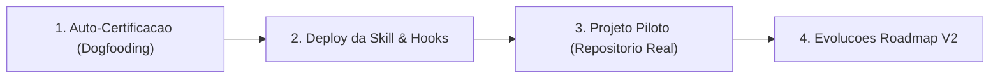

# Analise Comparativa: PRD, ADR, Specs Executadas e Proximos Passos do TRustKit

**Data:** 28 de Outubro de 2026  
**Localizacao:** `/home/mmc/00_code/00_tools/TRustKit/docs/analysis/20261028-analise-prd-adr-specs-e-proximos-passos.md`  
**Escopo:** Analise cruzada entre PRD, ADR-001, Guia de Bootstrapping e as quatro features executadas em `specs/`.

---

## 1. Diagnostico do Estado Atual (As-Is)

Todas as quatro fases do MVP definidas no PRD e no ADR-001 foram **implementadas, integradas e testadas com 100% de aprovacao na branch `develop`**:

| Feature / Especificacao | Fase PRD / ADR | Status no Repositorio | Entregaveis Validados |
| :--- | :---: | :---: | :--- |
| **`001-core-db-cli`** | **Fase 1** | Concluida e Mergeada | - Workspace Cargo modular.<br>- Crate `trustkit-core` pura (`std` only, zero dependencias externas).<br>- SQLite WAL com 5 tabelas e **100% `NOT NULL`** (sem uso de `null`).<br>- Hashing `BLAKE3` concorrente.<br>- Hooks sincronos `PreToolUse` com latencia media de **1,68 ms**.<br>- Guardiao de identidade GitHub (`GitHubIdentityGuard`) e sincronizacao 9 colunas. |
| **`002-spec-v2-dag-planner`** | **Fase 2** | Concluida e Mergeada | - Ingestao upstream `--from-prd` com extracao de RN e RF.<br>- Validacao sintatica de Mermaid `flowchart LR`, blocos Gherkin e fechamento da Matriz de Rastreabilidade.<br>- Congelamento criptografico (`spec lock`) com digest `BLAKE3`.<br>- Calculo de ondas de execucao topologicas via DAG em `petgraph` com deteccao de ciclos e segregacao de arquivos concorrentes. |
| **`003-ast-layer0-context-slicer`** | **Fase 3** | Concluida e Mergeada | - Camada 0 do Gauntlet (`trustkit gauntlet ast-audit`) em `< 5ms` (zero tokens).<br>- Auditor Anti-Cheat via `tree-sitter` (Rust e TS) impedindo remocao de assercoes (`expect`/`assert`) ou uso de `.skip`.<br>- Scanner lexico bloqueando emojis Unicode, trailers de IA (`Co-Authored-By`) e links externos proibidos.<br>- Fatiador de contexto sintatico (`AstContextSlicer`). |
| **`004-worktree-tdd-gauntlet`** | **Fase 4** | Concluida e Mergeada | - Provedor de Git Worktrees efemeras com isolamento por onda e symlinks de dependencias.<br>- Fiscalizacao deterministica de TDD: falha comprovada (`RED`) obrigatoria antes de avanco (`GREEN`).<br>- Despachante concorrente com redacao automatica de segredos.<br>- Guardiao visual do Playwright com restauracao automatica de evidencias alheias (`git checkout --`).<br>- Circuit Breaker com limite estrito de 5 falhas no Gauntlet.<br>- Geracao deterministica de relatorio de certificacao, merge seguro e abertura de PR sob demanda.<br>- Servidor MCP stdio (`mcp_stdio_server.rs`) e Thin Skill (`SKILL.md` v4 com 94 linhas). |

### Auditoria de Qualidade e Metricas Nao-Funcionais Aferidas

* **Pureza Arquitetural:** `cargo tree -p trustkit-core` confirma dependencia exclusiva da biblioteca padrao (`std`).
* **Qualidade de Codigo:** `cargo clippy --workspace --all-targets -- -D warnings` executa com **zero warnings**.
* **Suite de Testes:** Todos os testes unitarios, de integracao e contratos em `crates/*` foram aprovados.
* **Tamanho do Binario:** `7,8 MB` em modo release (meta do PRD: `< 25 MB`).
* **Cold-start de Comandos Criticos:**
  * `trustkit status --json`: **2,20 ms** (meta do PRD: `< 3 ms`).
  * `trustkit hook pre-tool`: **1,68 ms** (meta do PRD: `< 3 ms`).

---

## 2. Gaps e Oportunidades Identificados

1. **Ciclo de Dogfooding / Auto-Certificacao Incompleto:**
   Conforme estabelecido no `BOOTSTRAPPING_E_SELF_HOSTING.md`, o TRustKit deveria utilizar seus proprios comandos para gerar seu primeiro relatorio de certificacao oficial (`gauntlet-report.md`). No momento, o banco local `.trustkit/state.db` reteve apenas a sessao intermediaria `issue-3-202610281343` no Gate 3.
2. **Disponibilizacao da Thin Skill no Ambiente de Execucao:**
   A Thin Skill v4 foi redigida em `skills/trustkit/SKILL.md` e `.agents/skills/trustkit/SKILL.md`, mas ainda nao esta instalada no diretorio global de skills do ambiente (`~/.gemini/config/skills/trustkit`), impossibilitando o seu acionamento direto em outros repositorios via `/trustkit`.
3. **Instalacao Global e Hook nos Agentes Hospedeiros:**
   Embora o binario ja esteja linkado em `~/.local/bin/trustkit`, as configuracoes de hooks sincronos dos ambientes de agentes (Claude Code / Antigravity) ainda nao foram apontadas para `trustkit hook pre-tool`.
4. **Gramaticas Tree-Sitter Adicionais (Roadmap V2):**
   A Camada 0 possui suporte completo a AST para **Rust** e **TypeScript/TSX**, enquanto Python e Go utilizam o scanner lexico baseado em expressoes regulares.

---

## 3. Plano de Proximos Passos Recomendado



### Passo 1: Executar o Ritual de Auto-Certificacao (Dogfooding)
* **Objetivo:** Encerrar o ciclo de desenvolvimento do MVP gerando o primeiro `gauntlet-report.md` emitido pelo proprio binario sobre o repositorio do `TRustKit`.
* **Acoes:**
  1. Limpar/arquivar a sessao legada no `.trustkit/state.db`.
  2. Rodar a auditoria Camada 0:
     ```bash
     trustkit gauntlet ast-audit --json
     ```
  3. Executar a certificacao final no Gate 6 para consolidar o relatorio oficial:
     ```bash
     trustkit done --json
     ```

### Passo 2: Instalacao e Habilitacao da Thin Skill e Hooks Globais
* **Objetivo:** Permitir que o comando `/trustkit` esteja disponivel para todos os agentes nos projetos corporativos.
* **Acoes:**
  1. Copiar ou criar link simbolico da pasta `skills/trustkit` para `~/.gemini/config/skills/trustkit`.
  2. Validar o carregamento da skill no agente com verificacao de metadados e compatibilidade.
  3. Adicionar o hook sincrono `trustkit hook pre-tool` nas configuracoes locais de ferramentas dos agentes para interceptacao de comandos proibidos (`git stash`, commits sem padrao, uso de emojis).

### Passo 3: Execucao de um Projeto Piloto em Repositorio Real
* **Objetivo:** Homologar a orquestracao em campo com uma issue real do GitHub Projects v2 (ex: repositorio corporativo parceiro ou cliente).
* **Acoes:**
  1. Disparar `trustkit init --issue <ID> --from-prd <PRD>` em um repositorio cliente.
  2. Executar uma spec real com diagrama Mermaid e criterios Gherkin, verificando a criacao do selo `spec lock`.
  3. Rodar ondas com criacao de worktrees efemeras (`trustkit wave run`), validacao TDD e restauracao automatica de screenshots do Playwright.
  4. Certificar o ciclo e abrir o PR sob demanda com `trustkit pr`.

### Passo 4: Evolucoes do Roadmap V2
* **Objetivo:** Expandir a interoperabilidade tecnica conforme previsto no PRD.
* **Acoes:**
  1. Adicionar contadores de assercoes Tree-Sitter nativos para **Python** (`pytest` / `unittest`) e **Go** (`testing`).
  2. Configurar a integracao direta do servidor MCP `trustkit mcp` via `.mcp.json` para expor ferramentas nativas ao Claude Code e Antigravity IDE.
  3. Expor o comando CLI `trustkit contract unlock --file <path> --reason "..."` para flexibilizacao autorizada de assercoes protegidas.
