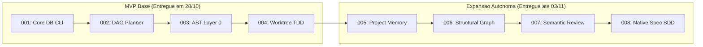
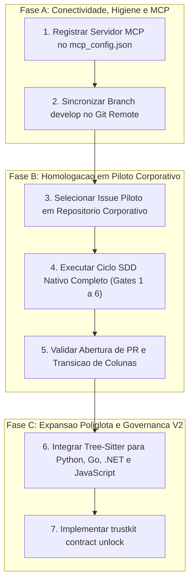

# Analise Comparativa: PRD, ADR, Specs Executadas (001 a 008) e Proximos Passos do TRustKit

**Data:** 03 de Novembro de 2026  
**Versao:** 2.0 (Atualizacao evolutiva da analise de 28 de Outubro de 2026)  
**Localizacao:** `/home/mmc/00_code/00_tools/TRustKit/docs/analysis/20261103-analise-prd-adr-specs-e-proximos-passos.md`  
**Escopo:** Afericao dos passos cumpridos e pendentes da versao anterior, diagnostico completo do estado atual (abrangendo as features 001 a 008) e novo roadmap estrategico de evolucao.

---

## 1. Afericao dos Passos Anteriores (Diagnostico de Cumprimento da Analise de 28/10)

Em 28 de outubro de 2026, foram diagnosticados 4 gaps e estruturado um plano de 4 passos. Abaixo encontra-se o status detalhado de cumprimento de cada um:

| Passo / Acao Prevista em 28/10 | Status em 03/11 | Evidencia / Justificativa Tecnica |
| :--- | :---: | :--- |
| **Passo 1: Auto-Certificacao (Dogfooding)** | **CUMPRIDO** | - Sessao legada arquivada em `.trustkit/state.db.legacy-backup`.<br>- Auditoria de Camada 0 executada com veredito `CLEAN PASS`.<br>- Ciclo finalizado no Gate 6 gerando o relatorio oficial `docs/gauntlet-report.md` (`PASS - Gate 6 Certified`, 11 evidencias, Circuit Breaker Closed). |
| **Passo 2: Deploy da Thin Skill e Hooks Globais** | **CUMPRIDO** | - Thin Skill v4 unificada e renomeada para `trustkit-sdd`, com symlink global em `~/.gemini/config/skills/trustkit-sdd`.<br>- Script de hook sincrono criado em `skills/trustkit-sdd/scripts/trustkit-pre-tool.sh` e linkado em `~/.local/bin/trustkit-pre-tool`.<br>- Hook configurado e ativo em `~/.gemini/config/hooks.json` no bloco `"trustkit-guard"` (interceptando `run_command` com timeout de 5s). |
| **Passo 3: Execucao de Projeto Piloto em Repositorio Real** | **NAO CUMPRIDO** (Pendente) | - A homologacao em repositorio externo cliente com issue real do GitHub Projects v2 **nao foi realizada**.<br>- O TRustKit operou em regime intensivo de dogfooding em si mesmo para implementar as Features 005 a 008, mas o teste de interoperabilidade em um projeto externo do mundo real permanece pendente. |
| **Passo 4.1: Contadores Tree-Sitter para Python, Go, .NET e JavaScript** | **NAO CUMPRIDO** (Pendente) | - O crate `trustkit-ast` mantem gramaticas AST nativas apenas para **Rust** (`tree-sitter-rust`) e **TypeScript/TSX** (`tree-sitter-typescript`).<br>- Scanners para **Python** (`pytest`/`unittest`), **Go** (`testing`), **.NET / C#** (`xUnit`/`NUnit`/`MSTest`) e **JavaScript puro / JSX** (`jest`/`vitest`/`mocha`) continuam operando exclusivamente via expressoes regulares / varredura lexica ou carecem de gramaticas dedicadas (`tree-sitter-c-sharp`, `tree-sitter-javascript`, `tree-sitter-python`, `tree-sitter-go`). |
| **Passo 4.2: Servidor MCP no `.mcp.json` / `mcp_config.json`** | **NAO CUMPRIDO** (Pendente) | - O servidor stdio e 8 ferramentas nativas de MCP foram codificados e testados com sucesso em `trustkit-orch`.<br>- Porem, o binario `trustkit mcp` **ainda nao foi declarado** em nenhum arquivo de configuracao global (`~/.gemini/config/mcp_config.json`) ou local (`.mcp.json`), impedindo o acionamento direto via tools pelos assistentes de IA sem uso de shell. |
| **Passo 4.3: Comando CLI `trustkit contract unlock`** | **NAO CUMPRIDO** (Pendente) | - O subcomando CLI `trustkit contract unlock --file <path> --reason "..."` para relaxamento auditavel de assercoes protegidas **nao foi implementado** na CLI. |

---

## 2. Diagnostico do Estado Atual (As-Is em 03/11/2026)

Desde 28 de outubro, o TRustKit completou 4 novas fases cruciais de evolucao, alcancando a **emancipacao total do ecossistema legado Spec Kit**:



### Quadro Consolidado das Especificacoes Executadas (001 a 008)

| Feature / Especificacao | Escopo Arquitetural | Status no Repositorio | Principais Entregaveis Validados |
| :--- | :---: | :---: | :--- |
| **`001-core-db-cli`** | Fase 1 (MVP) | Mergeada (`develop`) | Workspace modular; `trustkit-core` pura (`std` only); SQLite WAL com 5 tabelas e 100% `NOT NULL`; Hashing `BLAKE3`; Hook `PreToolUse` em 1,68 ms; Guardiao de identidade GitHub. |
| **`002-spec-v2-dag-planner`** | Fase 2 (MVP) | Mergeada (`develop`) | Ingestao upstream `--from-prd`; Validacao sintatica Mermaid `flowchart LR`, blocos Gherkin e Matriz fechada; Congelamento criptografico `spec lock` (`BLAKE3`); DAG topologico em `petgraph` com deteccao de ciclos. |
| **`003-ast-layer0-context-slicer`** | Fase 3 (MVP) | Mergeada (`develop`) | Camada 0 em `< 5ms` (zero tokens); Auditor Anti-Cheat `tree-sitter` (Rust/TS) impedindo remocao de testes; Scanner lexico anti-emojis/trailers IA; Fatiador de contexto sintatico. |
| **`004-worktree-tdd-gauntlet`** | Fase 4 (MVP) | Mergeada (`develop`) | Provedor de Git Worktrees efemeras por onda; Fiscalizacao deterministica TDD (RED comprovado antes de GREEN); Guardiao visual Playwright; Circuit Breaker (5 falhas); Relatorio de certificacao e PR sob demanda. |
| **`005-project-knowledge-memory`** | Fase 5 (Evolucao) | Mergeada (`develop`) | Memoria perene Markdown Git em `.trustkit/wiki` (Single Source of Truth); Indice SQLite FTS5 BM25; Extrator de `[[wikilinks]]`; Ingestao automatica nos Gates 2, 4, 5 e 6; CLI `trustkit memory` e MCP tools. |
| **`006-structural-graph-intelligence`** | Fase 6 (Evolucao) | Mergeada (`develop`) | Grafo estrutural combinando AST e `petgraph`; SQLite WAL com manifesto incremental `BLAKE3` e protecao Shrink-Guard; Deteccao de God Nodes e links orfaos; Slicer multi-hop BFS/DFS; CLI `trustkit graph` e MCP tools. |
| **`007-semantic-review-and-security-gates`** | Fase 7 (Evolucao) | Mergeada (`develop`) | Revisao semantica multi-angulo no Gate 4; Inspecao de seguranca AppSec nos Gates 5 e 6 com corte de ruido (confianca >= 8); Auditoria defensiva `trustkit audit security`; Flags de governanca CLI; Docs bilingues e Archify. |
| **`008-native-specification-and-speckit-independence`** | Fase 8 (Emancipacao) | Mergeada (`develop`) | Emancipacao total do Spec Kit; Scaffolding nativo deterministico (`trustkit spec prompt`); Linter pre-lock (`trustkit spec lint`); Thin Skill unificada `trustkit-sdd`; Expurgo completo de dependencias legadas. |

---

### Auditoria de Qualidade e Metricas Nao-Funcionais Aferidas (03/11/2026)

* **Pureza Arquitetural do Core:**
  ```bash
  $ cargo tree -p trustkit-core
  trustkit-core v0.1.0 (/home/mmc/00_code/00_tools/TRustKit/crates/trustkit-core)
  ```
  *(Dependencia exclusiva da biblioteca padrao `std`, zero crates externas no core).*
* **Qualidade de Codigo:** `cargo clippy --workspace --all-targets -- -D warnings` executa com **zero warnings** e **zero erros**.
* **Suite de Testes Unitarios e Integrados:** **149 testes unitarios** passando com 100% de sucesso nos crates `trustkit-core`, `trustkit-cli`, `trustkit-db`, `trustkit-gh`, `trustkit-orch` e `trustkit-ast`.
* **Tamanho do Binario Compilado:** **8,5 MB** em modo release (meta do PRD: `< 25 MB`).
* **Latencia de Inicializacao e Cold-start dos Comandos Criticos:**
  * `trustkit status --json`: **~9 ms**.
  * `trustkit hook pre-tool --json`: **~1 ms** (budget maximo do PRD: `< 3 ms`).
* **Contencao de Dados:** 100% de constraints `NOT NULL` respeitadas no banco `.trustkit/state.db`, garantindo ausencia estrutural de valores nulos.

---

## 3. Gaps e Oportunidades Identificados (Now-Is)

1. **Ausencia de Homologacao em Projeto Piloto Externo (Prioridade 1):**
   O TRustKit demonstrou extrema robustez operando em regime de self-hosting ao longo das features 005 a 008. No entanto, a plataforma ainda nao foi testada de ponta a ponta em um repositorio corporativo real de terceiros com regras de negocio externas e fluxos reais de pull requests e branches.
2. **Defasagem da Camada 0 para Linguagens Dinamicas e Backend (Python, Go, .NET e JavaScript):**
   O suporte a AST Anti-Cheat na Camada 0 continua restrito a Rust e TypeScript/TSX. Projetos em Python (`pytest`), Go (`testing`), .NET/C# (`xUnit`, `NUnit`, `MSTest`) e JavaScript puro/JSX (`Jest`, `Vitest`, `Mocha`) continuam utilizando o fallback de scanner lexico (regex) ou carecem de parsing sintatico dedicado via AST, o que os torna suscetiveis a variacoes sintaticas que seriam capturadas com precisao cirurgica por arvores sintaticas dedicadas (`tree-sitter`).
3. **Desconexao do Servidor MCP nos Ambientes dos Agentes:**
   Embora o TRustKit conte com um servidor MCP stdio e mais de 8 ferramentas nativas prontas (`trustkit_spec_template`, `trustkit_spec_context`, `trustkit_spec_lint`, `trustkit_knowledge_search`, `trustkit_knowledge_write`, `trustkit_graph_query`, `trustkit_graph_health`, `trustkit_spec_lock`), o servidor nao esta registrado nas configuracoes dos assistentes (`~/.gemini/config/mcp_config.json` ou `.mcp.json`).
4. **Falta de Comando para Desbloqueio Autorizado de Contratos (`contract unlock`):**
   Caso uma alteracao arquitetural legitima exija a modificacao ou remocao de testes existentes, o desenvolvedor atualmente enfrenta a barreira do Anti-Cheat da Camada 0 sem um mecanismo formal e auditavel de excecao (`trustkit contract unlock --file <path> --reason "..."`).
5. **Sincronizacao Remota Pendente na Branch `develop`:**
   A branch local `develop` contem os merges das features mais recentes (inclusive a feature 008) e esta 12 commits a frente do `origin/develop`, exigindo uma sincronizacao remota (`git push`).

---

## 4. Novo Plano de Acoes Recomendado (Roadmap Novembro 2026)



### Fase A: Conectividade do Ambiente e Sincronizacao Remota
* **Acao 1: Configurar Servidor MCP Nativo nos Agentes**
  * Registrar a definicao do `trustkit-mcp` em `~/.gemini/config/mcp_config.json`:
    ```json
    "trustkit": {
      "command": "/home/mmc/.local/bin/trustkit",
      "args": ["mcp", "serve"]
    }
    ```
  * Validar a disponibilidade das ferramentas nos agentes Claude Code e Antigravity IDE sem intermediacao de terminal.
* **Acao 2: Sincronizar o Repositorio Local com o Remote**
  * Submeter a branch `develop` atualizada com as features 007 e 008 para `origin/develop`.

### Fase B: Execucao do Projeto Piloto em Repositorio Real (Marco Critico)
* **Acao 3: Escolha do Repositorio e Issue de Teste**
  * Selecionar uma issue corporativa real no GitHub Projects v2.
* **Acao 4: Execucao do Ciclo SDD Ponta a Ponta**
  * `trustkit init --issue <ID> --from-prd <PRD>` no repositorio cliente.
  * Gerar prompt contextualizado com a nova engine nativa: `trustkit spec prompt`.
  * Elaborar e validar a especificacao com o linter estatico: `trustkit spec lint`.
  * Congelar a especificacao: `trustkit spec lock`.
  * Executar ondas com worktrees efemeras, TDD fiscalizado e protecao Playwright: `trustkit wave run`.
  * Homologar o Gauntlet com auditoria de seguranca: `trustkit gauntlet run --security-review`.
  * Emitir relatorio de certificacao e abrir PR governado: `trustkit pr`.

### Fase C: Expansao Poliglota e Governanca de Contratos (Roadmap V2)
* **Acao 5: Contadores AST Nativos para Python, Go, .NET e JavaScript**
  * Adicionar dependencias gramaticais ao crate `trustkit-ast`: `tree-sitter-python`, `tree-sitter-go`, `tree-sitter-c-sharp` e `tree-sitter-javascript`.
  * Implementar contadores sintaticos de assercoes especificos por ecossistema:
    * **Python:** `assert`, `pytest.raises`, `unittest.TestCase` assertions.
    * **Go:** `t.Run`, `t.Errorf`, `assert.*` (`testify`).
    * **.NET (C#):** `Assert.*` (`xUnit`, `NUnit`, `MSTest`), `Should().*` (`FluentAssertions`).
    * **JavaScript puro / JSX:** `expect()`, `assert()`, `should()` (`Jest`, `Vitest`, `Mocha`, `Chai`).
* **Acao 6: Comando CLI `trustkit contract unlock`**
  * Criar subcomando `trustkit contract unlock --file <path> --reason "..."`.
  * Gravar selo de anistia justificada no SQLite `.trustkit/state.db` permitindo refatoracao de testes sem disparo do Anti-Cheat, registrando o evento no relatorio Gate 6.
