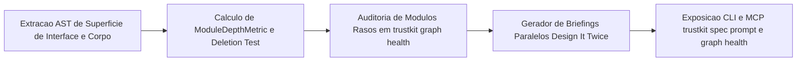

# Especificacao: deep-modules-and-seam-analysis

## 1. Product Trio

- **PM**: Agentes de codificacao tendem a acelerar a entropia arquitetural criando dezenas de modulos rasos (interfaces extensas ou funcoes pass-through que apenas repassam chamadas sem ocultar complexidade), tornando o repositorio dificil de navegar e testar. O TRustKit deve incorporar a disciplina de Modulos Profundos (John Ousterhout) e Costuras (Michael Feathers) diretamente na inteligencia de grafo estrutural (`trustkit graph health`) e na formulacao de especificacoes (`trustkit spec prompt --design-it-twice`), permitindo identificar mecanicamente modulos rasos pelo Deletion Test e explorar multiplas alternativas de interface antes do congelamento da especificacao.
- **Tech Lead**: Estender `trustkit-core` (`graph_entities.rs` e `spec_scaffold_entities.rs`) com as estruturas `ModuleDepthMetric`, `ShallowModuleCandidate`, `SeamClassification` e `DesignItTwiceBrief` (100% livres de `null` e restritas a `std`). No `trustkit-ast` (`graph_health_auditor.rs` e `ast_graph_extractor.rs`), calcular a razao entre a superficie publica exportada (metodos publicos, parametros e tipos expostos) e a densidade de implementacao interna via Tree-Sitter, sinalizando modulos pass-through que falham no Deletion Test. No `trustkit-cli` e `trustkit-orch` (MCP), expor a flag `--design-it-twice` no `trustkit spec prompt` e incluir o diagnostico de profundidade no `trustkit graph health`.
- **Design / QA**: Validar via testes unitarios e de integracao que a extracao de metricas de profundidade executa em menos de 15ms, identifica com precisao funcoes/modulos pass-through (alta superficie de interface vs. baixa complexidade encapsulada), gera os 3 briefings contrastantes do padrao Design It Twice sem valores nulos e mantem conformidade estrita com zero emojis e zero trailers de autoria de IA.

## 2. Diagrama de Fluxo (Mermaid)

## 3. Criterios de Aceitacao (Gherkin)

### Cenario 1: Calculo deterministico de profundidade de modulo via AST (Atendimento de RF-001)

- **Dado** um conjunto de arquivos Rust ou TypeScript analisados pelo extrator Tree-Sitter do `trustkit-ast`
- **Quando** o calculador de profundidade avalia as assinaturas publicas exportadas em relacao ao corpo de implementacao interna de cada modulo
- **Entao** o sistema produz uma estrutura `ModuleDepthMetric` classificando o modulo como `Deep`, `Balanced` ou `ShallowPassThrough` sem utilizar campos nulos.

### Cenario 2: Deteccao de candidatos a refatoracao pelo Deletion Test no Graph Health (Atendimento de RF-002)

- **Dado** um modulo cuja interface publica possui complexidade equivalente a sua implementacao ou que atua apenas como delegador pass-through para um unico adaptador
- **Quando** o comando `trustkit graph health --json` e executado
- **Entao** o relatorio inclui a lista `shallow_modules` indicando o arquivo, a costura afetada, a justificativa pelo Deletion Test e a recomendacao de aprofundamento.

### Cenario 3: Validacao de Costuras Reais vs Costuras Hipoteticas (Atendimento de RF-003)

- **Dado** o grafo estrutural contendo traits/interfaces (`Ports`) e suas implementacoes concretas (`Adapters`)
- **Quando** o auditor analisa a quantidade de adaptadores concretos ou fakes de teste conectados a cada porta
- **Entao** o auditor classifica a costura como `RealSeam` (dois ou mais adaptadores/testes) ou `HypotheticalSeam` (apenas um adaptador sem variacao), evitando abstracoes especulativas.

### Cenario 4: Geracao de briefings paralelos Design It Twice no Gate 1 (Atendimento de RF-004)

- **Dado** que o desenvolvedor ou agente deseja projetar uma nova porta ou modulo profundo durante o Gate 1
- **Quando** o comando `trustkit spec prompt --idea "<ideia>" --design-it-twice --json` e executado
- **Entao** o payload JSON retorna 3 briefings arquiteturais contrastantes (Minimizacao de Interface, Maxima Flexibilidade e Otimizacao para o Chamador Comum) prontos para despacho em subagentes paralelos.

### Cenario 5: Exposicao no servidor MCP e sincronizacao documental (Atendimento de RF-005)

- **Dado** o servidor MCP nativo e os manuais do TRustKit
- **Quando** a ferramenta `trustkit_graph_health` ou `trustkit_spec_context` e invocada via JSON-RPC 2.0
- **Entao** os dados de profundidade de modulos e costuras sao retornados em menos de 10ms e a documentacao oficial reflete o vocabulario de Deep Modules.

## 4. Matriz de Rastreabilidade

| Regra Negocio | Requisito Funcional | Tarefa | No Mermaid | Teste Unitario / Integracao | Evidencia / Verificacao |
| :--- | :--- | :--- | :--- | :--- | :--- |
| RN-001 | RF-001 | TASK-001 | Node1 | crates/trustkit-core/src/graph_entities_tests.rs | EV-001-module-depth-entities.json |
| RN-002 | RF-002 | TASK-002 | Node2 | crates/trustkit-ast/tests/graph_health_auditor_tests.rs | EV-002-shallow-module-deletion-test.json |
| RN-003 | RF-003 | TASK-003 | Node3 | crates/trustkit-ast/tests/ast_graph_extractor_tests.rs | EV-003-seam-classification-audit.json |
| RN-004 | RF-004 | TASK-004 | Node4 | crates/trustkit-core/src/spec_scaffold_entities_tests.rs | EV-004-design-it-twice-scaffold.json |
| RN-005 | RF-005 | TASK-005 | Node5 | crates/trustkit-cli/tests/mcp_graph_tools_tests.rs | EV-005-cli-mcp-depth-integration.json |
