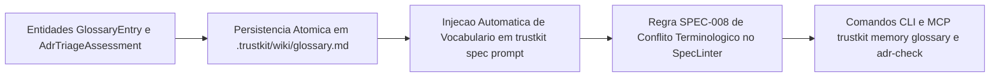

# Especificacao: ubiquitous-glossary-and-adr-triage

## 1. Product Trio

- **PM**: Agentes de IA frequentemente introduzem termos ambiguos, sinonimos concorrentes e jargoes de implementacao nas especificacoes e nos nomes de estruturas de codigo, gerando desalinhamento com os especialistas de dominio e inflando o consumo de tokens. O TRustKit deve gerenciar um Glossario de Linguagem Ubiqua ativo na memoria perene (`.trustkit/wiki/glossary.md`), confrontando termos banidos ou vagos durante o linting da especificacao (`trustkit spec lint`), injetando o vocabulario canonico automaticamente no Gate 1 e aplicando uma triagem deterministica de 3 criterios para aprovar apenas ADRs de alto valor.
- **Tech Lead**: Definir no `trustkit-core` (`knowledge_entities.rs`) as entidades `GlossaryEntry`, `DomainGlossary` e `AdrTriageAssessment` (avaliando os 3 criterios booleanos: `is_hard_to_reverse`, `is_surprising_without_context`, `has_genuine_alternatives_tradeoff`). No `trustkit-db` (`knowledge_ops.rs` e `knowledge_wiki_fs.rs`), implementar a leitura e escrita atomica de `.trustkit/wiki/glossary.md`. No `trustkit-ast` (`spec_linter.rs`), adicionar a regra `SPEC-008` que escaneia o documento `spec.md` contra os termos rejeitados/ambiguos do glossario e aponta o termo canonico substituto. No `trustkit-cli`, adicionar subcomandos `trustkit memory glossary` e `trustkit memory adr-check`.
- **Design / QA**: Garantir por testes automatizados que o linter detecta termos ambiguos em menos de 3ms, que o glossario rejeita descricoes contendo detalhes de implementacao (caminhos de arquivos ou snippets de codigo), que o filtro de ADR reprova decisoes triviais quando qualquer um dos 3 criterios estiver ausente e que todas as saidas respeitam a proibicao de `null` e de emojis.

## 2. Diagrama de Fluxo (Mermaid)

## 3. Criterios de Aceitacao (Gherkin)

### Cenario 1: Cadastro e validacao de termos canonicos no Glossario de Dominio (Atendimento de RF-001)

- **Dado** que o operador ou agente registra um novo conceito de dominio via `trustkit memory glossary add --term "Ciclo SDD" --definition "<definicao>" --reject "sessao avulsa,sprint ia"`
- **Quando** a entrada `GlossaryEntry` e validada pelo core e persistida em `.trustkit/wiki/glossary.md`
- **Entao** o termo canonico e seus sinonimos rejeitados sao salvos em formato Markdown padronizado e indexados no SQLite FTS5 sem permitir snippets de codigo na definicao.

### Cenario 2: Injecao automatica do Glossario no scaffolding de especificacao (Atendimento de RF-002)

- **Dado** um repositorio que possui termos cadastrados em `.trustkit/wiki/glossary.md`
- **Quando** o comando `trustkit spec prompt --idea "<ideia>" --json` ou a tool MCP `trustkit_spec_context` e executada
- **Entao** o payload inclui a secao `ubiquitous_glossary` obrigando o agente especificador a adotar exclusivamente os termos canonicos e evitar os sinonimos rejeitados.

### Cenario 3: Deteccao de termos ambiguos ou conflitantes pelo SpecLinter (Atendimento de RF-003)

- **Dado** um arquivo `spec.md` que utiliza um termo listado como rejeitado/ambiguo no glossario ativo do projeto
- **Quando** o comando `trustkit spec lint --file spec.md --json` e executado
- **Entao** o linter emite a violacao `SPEC-008` informando a linha exata, o termo ambiguo encontrado e o termo canonico que deve substitui-lo.

### Cenario 4: Triagem deterministica de 3 criterios para criacao de ADR (Atendimento de RF-004)

- **Dado** uma proposta de decisao arquitetural submetida a avaliacao via `trustkit memory adr-check`
- **Quando** qualquer um dos tres criterios (`hard-to-reverse`, `surprising-without-context`, `real-tradeoff`) for avaliado como falso
- **Entao** o motor retorna o veredito `SkipAdr` orientando a registrar a decisao apenas na especificacao ou no codigo, evitando poluicao documental em `docs/adr/`.

### Cenario 5: Persistencia de ADR aprovado com criterios completos (Atendimento de RF-005)

- **Dado** uma proposta de decisao arquitetural onde todos os 3 criterios obrigatorios sao verdadeiros
- **Quando** o comando `trustkit memory adr-check` aprova a decisao
- **Entao** o sistema retorna o veredito `ApproveAdr` e disponibiliza o template enxuto contendo Contexto, Alternativas Consideradas, Decisao e Consequencias.

## 4. Matriz de Rastreabilidade

| Regra Negocio | Requisito Funcional | Tarefa | No Mermaid | Teste Unitario / Integracao | Evidencia / Verificacao |
| :--- | :--- | :--- | :--- | :--- | :--- |
| RN-001 | RF-001 | TASK-001 | Node1 | crates/trustkit-core/src/knowledge_entities_tests.rs | EV-001-glossary-and-adr-entities.json |
| RN-002 | RF-002 | TASK-002 | Node2 | crates/trustkit-db/tests/knowledge_fts5_search_tests.rs | EV-002-glossary-wiki-persistence.json |
| RN-003 | RF-003 | TASK-003 | Node3 | crates/trustkit-core/tests/spec_context_composer_tests.rs | EV-003-spec-prompt-glossary-injection.json |
| RN-004 | RF-004 | TASK-004 | Node4 | crates/trustkit-ast/tests/spec_linter_tests.rs | EV-004-spec-linter-glossary-check.json |
| RN-005 | RF-005 | TASK-005 | Node5 | crates/trustkit-cli/tests/mcp_knowledge_tools_tests.rs | EV-005-cli-mcp-glossary-adr-triage.json |
