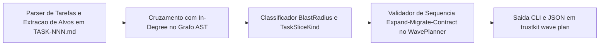

# Especificacao: expand-contract-wave-topology

## 1. Product Trio

- **PM**: Ao decompor uma especificacao em tarefas atomicas no Gate 3 (`trustkit wave plan`), mudancas mecanicas amplas (Wide Refactors que alteram um trait, struct ou contrato central usado por dezenas de arquivos) frequentemente causam colisao de merge ou quebra simultanea de compilacao entre Git Worktrees paralelas. O TRustKit deve distinguir automaticamente fatias verticais independentes (Tracer Bullets) de refatoracoes amplas (Wide Refactors) usando o grafo AST, impondo para estas ultimas a topologia de ondas Expand-Contract (Onda 1: Expand aditivo -> Onda 2: Migrate paralelo em lotes -> Onda 3: Contract de limpeza).
- **Tech Lead**: No `trustkit-core` (`ast_entities.rs` e `entities.rs`), introduzir os tipos `TaskSliceKind` (`VerticalTracerBullet`, `WideRefactorExpand`, `WideRefactorMigrateBatch`, `WideRefactorContract`) e `TaskBlastRadiusReport`. No `trustkit-ast` (`wave_coupling_analyzer.rs` e `wave_planner.rs`), cruzar os simbolos e arquivos declarados em `tasks/TASK-NNN.md` com o `in_degree` do grafo estrutural SQLite. Quando uma tarefa tocar um no com `in_degree` igual ou superior ao limiar configuravel sem seguir a sequencia `Expand -> Migrate -> Contract`, emitir alerta ou erro topologico no `trustkit wave plan` sugerindo o fatiamento seguro em 3 ondas.
- **Design / QA**: Verificar por meio de testes unitarios e E2E que tarefas do tipo `VerticalTracerBullet` continuam alocadas para maxima concorrencia nas worktrees, enquanto mudancas em simbolos de alto acoplamento (`GodNode` ou porta central) sao validadas quanto a presenca das etapas `Expand`, `Migrate` e `Contract`, mantendo o build verde em todas as ondas intermediarias.

## 2. Diagrama de Fluxo (Mermaid)

## 3. Criterios de Aceitacao (Gherkin)

### Cenario 1: Classificacao de fatia vertical Tracer Bullet com baixo acoplamento cruzado (Atendimento de RF-001)

- **Dado** um conjunto de tarefas em `tasks/TASK-NNN.md` onde cada tarefa corta verticalmente camadas distintas sem modificar assinaturas de simbolos de alto `in_degree`
- **Quando** o analisador `WaveCouplingAnalyzer` inspeciona as tarefas contra o grafo estrutural
- **Entao** as tarefas sao classificadas como `VerticalTracerBullet` e agendadas em ondas paralelas para execucao imediata nas Git Worktrees.

### Cenario 2: Deteccao automatica de Wide Refactor por alto Blast Radius no grafo AST (Atendimento de RF-002)

- **Dado** uma tarefa unica que modifica diretamente um trait ou struct central cujo `in_degree` no grafo estrutural excede o limiar de seguranca (ex: mais de 8 dependentes diretos)
- **Quando** o comando `trustkit wave plan --json` analisa o plano de ondas
- **Entao** o planejador identifica o risco de quebra em cascata (`HighBlastRadiusDetected`) e exige ou recomenda a decomposicao no padrao `Expand-Contract`.

### Cenario 3: Ordenacao topologica estrita das ondas Expand, Migrate e Contract (Atendimento de RF-003)

- **Dado** um conjunto de tarefas anotadas ou estruturadas como `WideRefactorExpand`, `WideRefactorMigrateBatch` e `WideRefactorContract`
- **Quando** o `WaveExecutionPlanner` calcula o DAG de execucao
- **Entao** a tarefa `Expand` e alocada isoladamente na primeira onda, todas as tarefas `MigrateBatch` rodam em paralelo na onda subsequente bloqueadas pela `Expand`, e a tarefa `Contract` e alocada na onda final bloqueada por todos os lotes `MigrateBatch`.

### Cenario 4: Rejeicao de tarefa Contract sem dependencia de todos os lotes Migrate (Atendimento de RF-004)

- **Dado** um plano de tarefas onde uma tarefa `WideRefactorContract` nao declara dependencia de todos os lotes `WideRefactorMigrateBatch` do mesmo topico
- **Quando** o validador de topologia do Gate 3 e executado
- **Entao** o comando `trustkit wave plan` rejeita o grafo com erro de violacao topologica informando exatamente qual aresta bloqueante esta faltando.

### Cenario 5: Exibicao de Blast Radius e tipo de fatia no relatorio do Gate 3 (Atendimento de RF-005)

- **Dado** um plano de ondas valido processado pelo `trustkit wave plan`
- **Quando** a saida e renderizada nos modos ASCII humano e `--json`
- **Entao** cada tarefa exibe seu `slice_kind` e `blast_radius_score` sem campos nulos e sem emojis.

## 4. Matriz de Rastreabilidade

| Regra Negocio | Requisito Funcional | Tarefa | No Mermaid | Teste Unitario / Integracao | Evidencia / Verificacao |
| :--- | :--- | :--- | :--- | :--- | :--- |
| RN-001 | RF-001 | TASK-001 | Node1 | crates/trustkit-core/src/ast_entities_tests.rs | EV-001-task-slice-kind-entities.json |
| RN-002 | RF-002 | TASK-002 | Node2 | crates/trustkit-ast/tests/wave_coupling_analyzer_tests.rs | EV-002-blast-radius-coupling.json |
| RN-003 | RF-003 | TASK-003 | Node3 | crates/trustkit-ast/tests/wave_planner_tests.rs | EV-003-expand-contract-dag-ordering.json |
| RN-004 | RF-004 | TASK-004 | Node4 | crates/trustkit-ast/tests/ast_facade_tests.rs | EV-004-contract-edge-validation.json |
| RN-005 | RF-005 | TASK-005 | Node5 | crates/trustkit-cli/tests/e2e_wave_plan.rs | EV-005-cli-wave-plan-expand-contract.json |
