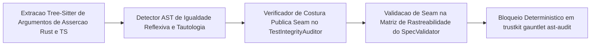

# Especificacao: tautological-test-and-seam-guard

## 1. Product Trio

- **PM**: Durante a fase TDD do Gate 4 e a auditoria AST do Gate 5, agentes podem cumprir a cota numerica de assercoes exigida pelo selo BLAKE3 escrevendo testes tautologicos (onde o valor esperado repete a mesma expressao ou chamada da implementacao, tornando a falha impossivel por construcao) ou acoplando os testes a detalhes privados em vez de testar a costura publica (Seam) acordada na especificacao. O TRustKit deve barrar mecanicamente assercoes tautologicas via Tree-Sitter na Camada 0 do Gauntlet e exigir que os testes referenciados na Matriz de Rastreabilidade exercitem costuras publicas validas.
- **Tech Lead**: No `trustkit-core` (`entities.rs` e `ast_entities.rs`), estender `AstViolation` com as variantes `TautologicalAssertion` e `UnapprovedInternalSeamCoupling`. No `trustkit-ast` (`rust_assertion_counter.rs`, `ts_assertion_counter.rs` e `test_integrity_auditor.rs`), inspecionar via Tree-Sitter os nos internos de `assert_eq!`, `assert!`, `expect().toBe()` e `expect().toEqual()` para detectar igualdade reflexiva (`left == right` com subarvores AST identicas), constantes comparadas consigo mesmas (`assert_eq!(42, 42)`) e ausencia de fontes independentes de verdade (literais ou fixtures). Evoluir o `SpecValidator` (`spec_validator.rs`) para validar a declaracao da costura publica sob teste na Matriz de Rastreabilidade.
- **Design / QA**: Garantir por testes automatizados que qualquer assercao reflexiva ou constante em Rust (`.rs`) e TypeScript (`.ts`/`.tsx`) dispare imediatamente `AstViolation::TautologicalAssertion` no `trustkit gauntlet ast-audit` com codigo de saida POSIX `4`, mantendo latencia de varredura inferior a 5ms e zero falsos positivos em testes legitimos baseados em fixtures.

## 2. Diagrama de Fluxo (Mermaid)

## 3. Criterios de Aceitacao (Gherkin)

### Cenario 1: Bloqueio de assercao reflexiva e constante em arquivos Rust (Atendimento de RF-001)

- **Dado** um arquivo de teste Rust contendo `assert_eq!(calcular(x), calcular(x))` ou `assert_eq!(true, true)`
- **Quando** o `RustAssertionCounter` e o `TestIntegrityAuditor` inspecionam a arvore sintatica do arquivo
- **Entao** a assercao nao e contabilizada como valida e o auditor emite `AstViolation::TautologicalAssertion` indicando arquivo, linha e expressao infratora.

### Cenario 2: Bloqueio de assercao tautologica em arquivos TypeScript (Atendimento de RF-002)

- **Dado** um arquivo de teste TypeScript contendo `expect(fn(a)).toBe(fn(a))` ou `expect(1).toEqual(1)`
- **Quando** o `TsAssertionCounter` analisa a AST da chamada `expect`
- **Entao** o analisador classifica a assercao como tautologica e reporta a violacao na Camada 0 do Gauntlet.

### Cenario 3: Verificacao de acoplamento a costura publica Pre-Agreed Seam (Atendimento de RF-003)

- **Dado** um teste vinculado a uma tarefa SDD que invoca diretamente funcoes internas privadas ou acessa estado interno contornando a interface publica do modulo
- **Quando** o `TestIntegrityAuditor` cruza as chamadas do teste com os nos publicos do grafo estrutural AST
- **Entao** o auditor emite `AstViolation::UnapprovedInternalSeamCoupling` orientando a testar atraves da porta ou interface publica do modulo.

### Cenario 4: Rastreabilidade explicita da costura sob teste na especificacao (Atendimento de RF-004)

- **Dado** uma especificacao `spec.md` submetida ao `SpecValidator` e ao `SpecLinter`
- **Quando** a Matriz de Rastreabilidade e inspecionada no Gate 1 e no Gate 2
- **Entao** o validador confirma que cada linha mapeia um teste verificavel associado a uma costura de modulo valida sem lacunas de rastreabilidade.

### Cenario 5: Reprovacao imediata no comando CLI trustkit gauntlet ast-audit (Atendimento de RF-005)

- **Dado** um repositorio com ao menos uma assercao tautologica introduzida no ciclo ativo
- **Quando** o comando `trustkit gauntlet ast-audit --json` e executado
- **Entao** o binario retorna codigo de saida POSIX `4` (`AstIntegrityOrInvariantViolation`) listando todas as assercoes tautologicas para correcao obrigatoria.

## 4. Matriz de Rastreabilidade

| Regra Negocio | Requisito Funcional | Tarefa | No Mermaid | Teste Unitario / Integracao | Evidencia / Verificacao |
| :--- | :--- | :--- | :--- | :--- | :--- |
| RN-001 | RF-001 | TASK-001 | Node1 | crates/trustkit-ast/tests/rust_assertion_counter_tests.rs | EV-001-rust-tautological-assertion.json |
| RN-002 | RF-002 | TASK-002 | Node2 | crates/trustkit-ast/tests/ts_assertion_counter_tests.rs | EV-002-ts-tautological-assertion.json |
| RN-003 | RF-003 | TASK-003 | Node3 | crates/trustkit-ast/tests/test_integrity_tests.rs | EV-003-public-seam-coupling-guard.json |
| RN-004 | RF-004 | TASK-004 | Node4 | crates/trustkit-ast/tests/spec_validator_tests.rs | EV-004-spec-seam-traceability.json |
| RN-005 | RF-005 | TASK-005 | Node5 | crates/trustkit-cli/tests/e2e_gauntlet_ast_audit.rs | EV-005-cli-ast-audit-tautology.json |
