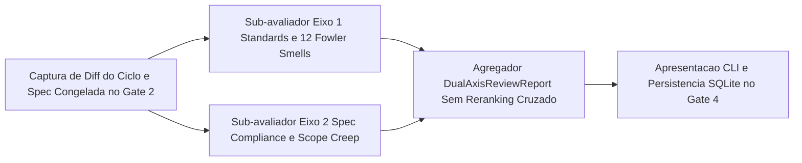

# Especificacao: dual-axis-review-and-fowler-smells

## 1. Product Trio

- **PM**: Na revisao semantica do Gate 4 (`trustkit task review`), consolidar todos os apontamentos em uma unica lista permite que um codigo bem formatado passe na revisao mesmo tendo introduzido funcionalidades nao pedidas (Scope Creep) ou deixado de atender um requisito da especificacao congelada, e vice-versa. O TRustKit deve separar estritamente a revisao em dois eixos independentes e nao-compensaveis: o Eixo Standards & Fowler Smells (conformidade com padroes do projeto mais baseline dos 12 Code Smells de Martin Fowler) e o Eixo Spec Compliance (atendimento integral da `spec.md` e bloqueio de Scope Creep).
- **Tech Lead**: Atualizar `trustkit-core` (`semantic_review_entities.rs`) adicionando os enums `ReviewAxis` (`StandardsAndSmells`, `SpecCompliance`), `FowlerCodeSmell` (`MysteriousName`, `DuplicatedCode`, `Feature Envy`, `DataClumps`, `PrimitiveObsession`, `RepeatedSwitches`, `ShotgunSurgery`, `DivergentChange`, `SpeculativeGenerality`, `MessageChains`, `MiddleMan`, `RefusedBequest`), `SpecComplianceDefect` (`MissingOrPartialRequirement`, `WrongImplementation`, `ScopeCreep`) e a estrutura agregadora `DualAxisReviewReport`. No caso de uso do Gate 4 (`gate4_code_review_use_case_tests.rs`) e no `trustkit-cli`, garantir que os dois eixos sejam executados e reportados separadamente, sem re-ranqueamento cruzado, exigindo aprovacao simultanea em ambos os eixos.
- **Design / QA**: Validar via suite de testes unitarios e de integracao que uma falha em `SpecCompliance` (ex: `ScopeCreep` detectado) reprova o veredito final mesmo quando `StandardsAndSmells` apresenta zero achados, que os padroes documentados do repositorio prevalecem sobre heuristicas de smell quando houver endosso explicito, e que a saida JSON preserva os dois eixos segregados sem valores `null`.

## 2. Diagrama de Fluxo (Mermaid)

## 3. Criterios de Aceitacao (Gherkin)

### Cenario 1: Modelagem dos 12 Code Smells de Fowler e defeitos de Spec Compliance (Atendimento de RF-001)

- **Dado** o modulo de entidades de revisao semantica no `trustkit-core`
- **Quando** um apontamento de revisao e instanciado
- **Entao** ele e tipado estritamente sob o eixo `StandardsAndSmells` (distinguindo violacao rigida do repositorio de julgamento heuristico `FowlerCodeSmell`) ou sob o eixo `SpecCompliance` (`MissingOrPartialRequirement`, `WrongImplementation`, `ScopeCreep`).

### Cenario 2: Deteccao de Scope Creep contra a especificacao congelada (Atendimento de RF-002)

- **Dado** um diff na worktree da tarefa que adiciona estruturas, flags ou comportamentos publicos nao previstos em nenhuma regra `RN-XXX` ou requisito `RF-XXX` da `spec.md` selada
- **Quando** o avaliador do eixo `SpecCompliance` compara o diff com a especificacao
- **Entao** o avaliador registra um achado `SpecComplianceDefect::ScopeCreep` citando o trecho excedente e reprova o eixo `SpecCompliance`.

### Cenario 3: Supremacia de padrao documentado do repositorio sobre smell heuristico (Atendimento de RF-003)

- **Dado** que o baseline de Fowler sinalizaria um smell heuristico (como `RepeatedSwitches`), mas as regras do repositorio em `AGENTS.md` ou `.claude/rules/` endossam explicitamente `match` exaustivo sem polimorfismo dinamico
- **Quando** o avaliador do eixo `StandardsAndSmells` processa as regras do repositorio
- **Entao** o padrao documentado do repositorio suprime o smell conflitante, evitando falsos positivos contra a arquitetura local.

### Cenario 4: Proibicao de compensacao ou fusao entre os dois eixos (Atendimento de RF-004)

- **Dado** um `DualAxisReviewReport` onde o eixo `StandardsAndSmells` obteve veredito `PASS` com zero problemas, mas o eixo `SpecCompliance` obteve veredito `FAIL`
- **Quando** o resultado consolidado do comando `trustkit task review <TASK_ID>` e calculado
- **Entao** o veredito global da revisao e `FAIL`, mantendo as secoes `standards_axis` e `spec_axis` independentes no JSON e no terminal ASCII.

### Cenario 5: Homologacao integrada no comando trustkit task complete (Atendimento de RF-005)

- **Dado** a conclusao de uma tarefa no Gate 4 com a flag `--code-review medium` ou superior
- **Quando** ambos os eixos (`StandardsAndSmells` e `SpecCompliance`) retornam `PASS`
- **Entao** a evidencia dual-axis e gravada no SQLite WAL e a tarefa e marcada como concluida com codigo de saida `0`.

## 4. Matriz de Rastreabilidade

| Regra Negocio | Requisito Funcional | Tarefa | No Mermaid | Teste Unitario / Integracao | Evidencia / Verificacao |
| :--- | :--- | :--- | :--- | :--- | :--- |
| RN-001 | RF-001 | TASK-001 | Node1 | crates/trustkit-core/src/semantic_review_entities_tests.rs | EV-001-dual-axis-and-fowler-entities.json |
| RN-002 | RF-002 | TASK-002 | Node3 | crates/trustkit-core/tests/gate4_code_review_use_case_tests.rs | EV-002-spec-scope-creep-detection.json |
| RN-003 | RF-003 | TASK-003 | Node2 | crates/trustkit-ast/tests/lexical_scanner_tests.rs | EV-003-repo-standard-override-smell.json |
| RN-004 | RF-004 | TASK-004 | Node4 | crates/trustkit-cli/src/presenter_tests.rs | EV-004-dual-axis-non-compensatory.json |
| RN-005 | RF-005 | TASK-005 | Node5 | crates/trustkit-cli/tests/e2e_gates_4_to_6.rs | EV-005-e2e-gate4-dual-review.json |
