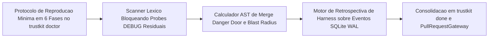

# Especificacao: diagnostic-loop-merge-danger-and-retro

## 1. Product Trio

- **PM**: Quando o Gauntlet falha repetidamente (acionando o Circuit Breaker no Gate 5) ou quando o ciclo se encerra no Gate 6 (`trustkit done` e `trustkit pr`), faltam tres disciplinas operacionais: (1) um protocolo estruturado de depuracao no `trustkit doctor` que exija um loop de reproducao minima antes de formular hipoteses e impeca que logs temporarios `[DEBUG-...]` sobrevivam ate o merge; (2) a declaracao automatica de Merge Danger (One-Way Door vs Two-Way Door + Blast Radius) no corpo do Pull Request; e (3) uma Retrospectiva de Harness pos-sessao que converta falhas recorrentes do ciclo em melhorias deterministicas de ambiente.
- **Tech Lead**: No `trustkit-core` (`gauntlet_entities.rs` e `ports.rs`), adicionar os modelos `DiagnosticBugLoopPlan`, `MergeDangerClassification` (`OneWayDoor`, `TwoWayDoor`), `BlastRadiusLevel` (`Isolated`, `ModuleLocal`, `CrossCrate`, `SystemWide`) e `HarnessRetroReport`. No `trustkit-ast` (`lexical_scanner.rs`), adicionar deteccao de marcadores residuais de instrumentacao (`[DEBUG-`) em `InvariantLexicalScanner`. No `trustkit-gh` (`pr_gateway.rs`) e `trustkit-orch` (`certification_reporter.rs`), calcular e injetar a secao `## Merge Danger` no corpo do PR e gerar a retrospectiva de harness no `trustkit done` a partir dos eventos gravados no SQLite WAL.
- **Design / QA**: Testar mecanicamente que qualquer tag `[DEBUG-xxxx]` esquecida no codigo bloqueia o Gate 5 com `AstViolation`, que mudancas em migracoes SQLite ou portas publicas de `trustkit-core` sao classificadas automaticamente como `OneWayDoor` no PR, e que o `trustkit done` consolida as recomendacoes de retrospectiva ordenadas por severidade sem campos nulos.

## 2. Diagrama de Fluxo (Mermaid)

## 3. Criterios de Aceitacao (Gherkin)

### Cenario 1: Emissao do plano de depuracao em 6 fases pelo trustkit doctor (Atendimento de RF-001)

- **Dado** um ciclo SDD com falhas registradas no Gauntlet ou com o Circuit Breaker acionado
- **Quando** o operador ou agente executa `trustkit doctor --json`
- **Entao** o diagnostico retorna o `DiagnosticBugLoopPlan` estruturado nas 6 fases (Loop que fica vermelho, Minimizacao de Repro, 3 a 5 Hipoteses Falsificaveis, Instrumentacao com prefixo `[DEBUG-xxxx]`, Correcao na Costura Certa e Limpeza).

### Cenario 2: Bloqueio lexico de instrumentacao temporaria DEBUG esquecida no codigo (Atendimento de RF-002)

- **Dado** um arquivo de codigo-fonte contendo logs de instrumentacao temporaria com o prefixo `[DEBUG-` (ex: `println!("[DEBUG-a4f2] state={:?}", s)`)
- **Quando** o `InvariantLexicalScanner` executa durante o `trustkit gauntlet ast-audit` ou `trustkit done`
- **Entao** o scanner emite uma violacao de invariante lexical impedindo a homologacao ate que todos os marcadores `[DEBUG-` sejam removidos.

### Cenario 3: Calculo deterministico de Merge Danger One-Way vs Two-Way Door no PR (Atendimento de RF-003)

- **Dado** o diff consolidado do ciclo pronto para abertura de Pull Request via `trustkit pr`
- **Quando** o calculador de risco analisa os arquivos e nos afetados no grafo estrutural
- **Entao** mudancas que alteram migracoes de banco (`migrations.rs`), schemas persistidos ou contratos de portas publicas sao classificadas como `OneWayDoor`, enquanto mudancas restritas a adaptadores internos ou testes sao classificadas como `TwoWayDoor`, acompanhadas do `BlastRadiusLevel` e incluidas obrigatoriamente no corpo do PR.

### Cenario 4: Geracao automatica de Retrospectiva de Harness no fechamento do ciclo (Atendimento de RF-004)

- **Dado** o historico de eventos, interceptacoes de `pre-tool` hook e reprovacoes do Gauntlet armazenados em `.trustkit/state.db` durante o ciclo ativo
- **Quando** o comando `trustkit done --json` e executado no Gate 6
- **Entao** o sistema gera um `HarnessRetroReport` apontando oportunidades de melhoria no ambiente (Novas Checagens Automatizadas, Ponteiros de Navegacao, Economia de Ferramentas e Regras de Revisao) ordenadas por severidade.

### Cenario 5: Validacao completa nos relatórios de certificacao e contratos CLI (Atendimento de RF-005)

- **Dado** a conclusao do Gate 6 com geracao do arquivo `gauntlet-report.md`
- **Quando** o relatorio e inspecionado e os testes de contrato CLI sao executados
- **Entao** o `gauntlet-report.md` contem as secoes de Merge Danger e Retrospectiva de Harness em ASCII puro, sem emojis e sem trailers de IA.

## 4. Matriz de Rastreabilidade

| Regra Negocio | Requisito Funcional | Tarefa | No Mermaid | Teste Unitario / Integracao | Evidencia / Verificacao |
| :--- | :--- | :--- | :--- | :--- | :--- |
| RN-001 | RF-001 | TASK-001 | Node1 | crates/trustkit-core/src/gauntlet_entities_tests.rs | EV-001-diagnostic-loop-plan-entities.json |
| RN-002 | RF-002 | TASK-002 | Node2 | crates/trustkit-ast/tests/lexical_scanner_tests.rs | EV-002-debug-tag-lexical-guard.json |
| RN-003 | RF-003 | TASK-003 | Node3 | crates/trustkit-core/tests/certification_merge_pr_use_case_tests.rs | EV-003-merge-danger-door-blast-radius.json |
| RN-004 | RF-004 | TASK-004 | Node4 | crates/trustkit-db/tests/sqlite_tdd_and_cert_tests.rs | EV-004-harness-retro-wal-analysis.json |
| RN-005 | RF-005 | TASK-005 | Node5 | crates/trustkit-cli/tests/e2e_gates_4_to_6.rs | EV-005-e2e-done-pr-retro-report.json |
