# Especificacao: autonomous-task-atomization

## 1. Product Trio

- **PM**: O comando `trustkit auto` apresenta falhas estruturais que impedem a autonomia operacional de ponta a ponta. Quando acionado contra uma especificacao (`--spec`) ou issue (`--issue`) sem diretorio `tasks/` pre-existente, o motor avanca silenciosamente pelos Gates 0 a 6 com zero ondas e zero tarefas, produzindo zero commits e inviabilizando Pull Requests. Adicionalmente, quando as tarefas existem no Gate 3 mas os arquivos de teste ainda nao foram criados no disco, o `cargo test` filtra zero testes e retorna exit code 0 na fase RED, disparando falso positivo de burla no anti-cheat TDD; ou, se um erro de sintaxe impedir a compilacao, o exit code nao-zero mascara um erro de compilacao como falha de assercao valida. Por fim, o merge de worktrees em branches distintos executa force-reset (`git branch -f`) que descarta commits de tarefas irmas na mesma onda. O `trustkit auto` deve atomizar deterministicamente a especificacao ou issue no Gate 3, aplicar um Circuit Breaker contra backlogs vazios, gerar scaffolding de teste RED compilavel que falha exclusivamente por assercao de dominio, despachar o agente construtor entre as fases RED e GREEN, distinguir falhas de compilacao de falhas de assercao e realizar merge real preservando todo o historico de commits da onda.
- **Tech Lead**: Implementar a blindagem completa do fluxo autonomo respeitando a arquitetura hexagonal estrita do TRustKit. No `trustkit-core`, definir as entidades `AtomizationSource`, `AtomicTaskDraft`, `RedTestScaffold`, o port `TaskAtomizerPort`, o port `BuilderAgentDispatcherPort` e as violacoes `EmptyTaskBacklogFault`, `ZeroFilteredTestsFault` e `CompilationFailureInRedPhaseFault`. No `trustkit-ast`, desenvolver o `SpecMatrixAtomizer` para extrair da Matriz de Rastreabilidade (secao 4), do diagrama Mermaid (secao 2) e dos cenarios Gherkin (secao 3) as tarefas atomicas `tasks/TASK-NNN.md` e sintetizar os esqueletos de teste RED compilaveis com assercoes de falha explicitas. No `trustkit-gh`, implementar o `IssueBodyAtomizer` para extrair requisitos do corpo de GitHub Issues. No `trustkit-orch`, refatorar o `AutonomousWaveOrchestrator` para validar na saida do `cargo test` que ao menos um teste foi executado (`filtered out` vs `1 failed`) e que nao houve erro de compilacao (`error[E`), acionar o `BuilderAgentDispatcherPort` entre as fases RED e GREEN com isolamento de `CARGO_TARGET_DIR` ou controle de concorrencia, e corrigir o `WorktreeIsolationProvider::merge_and_prune_worktree` para realizar merge/cherry-pick sem perder commits anteriores nem usar `branch -f` destrutivo. No `trustkit-cli` (`auto_cmd.rs`), integrar o pipeline completo com saida JSON sem null, zero panics e conformidade constitucional.
- **Design / QA**: Garantir por suite de testes automatizados TDD que especificacoes e issues geram tarefas atomicas aciclicas em menos de 50ms, que o Circuit Breaker bloqueia ciclos com zero tarefas no Gate 3 (exit code 1), que o scaffolding de teste RED evita o filtro vazio do Cargo (`0 passed; 0 failed`) e rejeita erros de compilacao do `rustc` na fase RED, que multiplas worktrees na mesma onda tem seus commits preservados integralmente no branch de destino sem sobrescrita, e que todas as saidas respeitam a proibicao de `null`, de emojis e de trailers de IA.

## 2. Diagrama de Fluxo (Mermaid)

```mermaid
flowchart LR
    SourceInput[Especificacao ou Issue de Entrada] --> BacklogCheck[Verificacao de Tarefas Existentes no Ciclo]
    BacklogCheck --> AstMatrixParser[Extracao AST da Matriz Gherkin e Issue Body]
    AstMatrixParser --> TaskSynthesizer[Sintese de tasks/TASK-NNN.md no Disco e SQLite]
    TaskSynthesizer --> CircuitBreaker[Circuit Breaker: Total de Tarefas Maior que Zero?]
    CircuitBreaker --> WaveScheduler[Planejamento DAG de Ondas no Gate 3]
    WaveScheduler --> RedScaffolder[Scaffolding de Teste RED Compilavel na Worktree]
    RedScaffolder --> RedVerifier[Verificador RED: Compila e Falha >= 1 Teste?]
    RedVerifier --> BuilderDispatch[Dispatch do Agente Construtor para Fase GREEN]
    BuilderDispatch --> SafeWorktreeMerge[Merge Acumulativo Seguro sem Force Reset]
```

## 3. Criterios de Aceitacao (Gherkin)

### Cenario 1: Atomizacao automatica nominal a partir da Matriz de Rastreabilidade ou Issue (Atendimento de RF-001, RF-002 e RF-004)

- **Dado** uma especificacao formal valida ou uma GitHub Issue contendo requisitos funcionais, cenarios Gherkin e mapeamento de tarefas em um ciclo sem pasta `tasks/` pre-existente
- **Quando** o comando `trustkit auto --spec <caminho_spec> --target develop --json` ou `trustkit auto --issue <id> --target develop --json` for executado
- **Entao** o motor deve decompor a entrada, materializar os arquivos `tasks/TASK-NNN.md` no disco, registrar os metadados no SQLite WAL sem sobrescrever tarefas customizadas pre-existentes e planejar o grafo DAG no Gate 3.

### Cenario 2: Circuit Breaker contra execucao espuria de ciclo vazio (Atendimento de RF-003)

- **Dado** uma especificacao ou issue que nao contenha itens de trabalho acionaveis e resulte em zero tarefas atomicas apos a etapa de atomizacao
- **Quando** o comando `trustkit auto` tentar concluir o Gate 3 e ingressar no Gate 4
- **Entao** o motor deve acionar a violacao `EmptyTaskBacklogFault`, abortar imediatamente a transicao para o Gate 4 com exit code 1 e jamais homologar ou mesclar um ciclo sem tarefas.

### Cenario 3: Scaffolding de Teste RED compilavel e bloqueio de filtro vazio ou erro de compilacao (Atendimento de RF-005 e RF-006)

- **Dado** que uma tarefa atomica ingressa no Gate 4 dentro de sua worktree isolada e seu arquivo de teste alvo ainda nao existe ou esta sendo validado na fase RED
- **Quando** o `AutonomousWaveOrchestrator` provisionar a worktree e executar a verificacao da fase RED
- **Entao** o motor deve gerar o esqueleto de teste RED compilavel quando ausente, rejeitar saidas do Cargo onde zero testes foram executados (`0 passed; 0 failed`) com `ZeroFilteredTestsFault`, rejeitar falhas de compilacao do `rustc` com `CompilationFailureInRedPhaseFault` e aprovar a fase RED exclusivamente quando o binario de teste compilar e ao menos uma assercao de teste falhar.

### Cenario 4: Dispatch do Agente Construtor entre as fases RED e GREEN (Atendimento de RF-007)

- **Dado** uma tarefa na worktree isolada que acaba de ter sua evidencia criptografica da fase RED comprovada e registrada no SQLite WAL
- **Quando** o orquestrador autonomo avancar para a etapa de implementacao antes de aferir a fase GREEN
- **Entao** o motor deve invocar o `BuilderAgentDispatcherPort` configurado para materializar o codigo de producao na worktree, controlar locks de compilacao do Cargo e somente entao executar a verificacao da fase GREEN exigindo exit code 0 com testes executados maiores que zero.

### Cenario 5: Merge acumulativo seguro de multiplas worktrees sem perda de commits (Atendimento de RF-008)

- **Dado** uma onda de execucao contendo multiplas tarefas atomicas que produziram commits independentes em suas respectivas worktrees
- **Quando** o `WorktreeIsolationProvider::merge_and_prune_worktree` integrar cada tarefa concluida ao branch de trabalho e ao branch alvo
- **Entao** o provedor deve realizar merge real verificado sem utilizar `git branch -f` destrutivo, abortar explicitamente caso ocorra conflito de merge do Git e preservar todos os commits das tarefas da onda para viabilizar a abertura do Pull Request via `trustkit pr`.

## 4. Matriz de Rastreabilidade

| Regra Negocio | Requisito Funcional | Tarefa | No Mermaid | Teste Unitario / Integracao | Evidencia / Verificacao |
| :--- | :--- | :--- | :--- | :--- | :--- |
| RN-001 | RF-001 | TASK-001 | AstMatrixParser | crates/trustkit-ast/tests/spec_matrix_atomizer_tests.rs | EV-001-spec-matrix-ast-atomization.json |
| RN-002 | RF-002 | TASK-002 | TaskSynthesizer | crates/trustkit-orch/tests/task_synthesis_fs_tests.rs | EV-002-task-file-synthesis.json |
| RN-003 | RF-003 | TASK-003 | CircuitBreaker | crates/trustkit-core/tests/empty_backlog_circuit_breaker_tests.rs | EV-003-circuit-breaker-empty-tasks.json |
| RN-004 | RF-004 | TASK-004 | SourceInput | crates/trustkit-gh/tests/issue_body_atomizer_tests.rs | EV-004-issue-body-atomization.json |
| RN-005 | RF-005 | TASK-005 | RedScaffolder | crates/trustkit-ast/tests/red_test_scaffolder_tests.rs | EV-005-red-test-scaffolder.json |
| RN-006 | RF-006 | TASK-006 | RedVerifier | crates/trustkit-core/tests/tdd_red_output_verifier_tests.rs | EV-006-tdd-red-output-verifier.json |
| RN-007 | RF-007 | TASK-007 | BuilderDispatch | crates/trustkit-orch/tests/builder_agent_dispatch_tests.rs | EV-007-builder-agent-dispatch.json |
| RN-008 | RF-008 | TASK-008 | SafeWorktreeMerge | crates/trustkit-orch/tests/safe_worktree_merge_tests.rs | EV-008-safe-worktree-merge.json |
| RN-009 | RF-009 | TASK-009 | WaveScheduler | crates/trustkit-cli/tests/cli_auto_atomization_e2e_tests.rs | EV-009-cli-auto-atomization-e2e.json |
