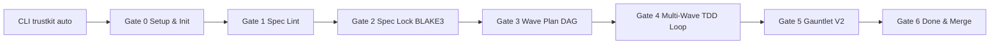

# Especificacao: motor-autonomo-trustkit-auto

## 1. Product Trio

- **PM**: Permitir que operadores e agentes executem o ciclo completo de desenvolvimento de uma funcionalidade de forma totalmente autonoma atraves do comando `trustkit auto`. O comando deve aceitar tanto uma issue remota do GitHub (`--issue <link|id>`) quanto um arquivo fisico local de especificacao (`--spec <caminho>`), percorrendo deterministamente todos os 7 gates do SDD e orquestrando sequencialmente todas as ondas topologicas (waves) e tarefas atomicas sob TDD estrito.
- **Tech Lead**: Implementar o subcomando `auto` no crate `trustkit-cli`, delegando a orquestracao hexagonal ao caso de uso `run_autonomous_cycle` no `trustkit-core`. Integrar com os adaptadores de persistencia SQLite WAL (`trustkit-db`), inspecao Git e board (`trustkit-gh`), e isolamento de worktrees com supervisor assincrono (`trustkit-orch`). Garantir zero panic, zero emojis, zero trailers de IA e saida JSON sem campos nulos quando solicitado.
- **Design / QA**: Assegurar cobertura BDD em cenarios nominais (execucao de 3 waves completas), cenarios com especificacao local invalida (aborto imediato no Gate 1), falha de TDD (bloqueio no Gate 4) e interrupcao segura via disjuntor (Circuit Breaker) caso o Gauntlet reprove.

## 2. Diagrama de Fluxo (Mermaid)

## 3. Criterios de Aceitacao (Gherkin)

### Cenario 1: Execucao autonoma nominal com arquivo local de especificacao (Atendimento de RF-001 e RF-002)

- **Dado** um arquivo fisico de especificacao valido em "docs/specs/exemplo/spec.md"
- **Quando** o desenvolvedor executar `trustkit auto --spec docs/specs/exemplo/spec.md`
- **Entao** o motor deve inicializar o ciclo no Gate 0, validar o linter no Gate 1, selar com BLAKE3 no Gate 2 e gerar o plano de ondas no Gate 3 com saida CleanPass.

### Cenario 2: Orquestracao sequencial de multiplas ondas topologicas no Gate 4 (Atendimento de RF-003 e RF-004)

- **Dado** um plano topologico com 3 ondas contendo tarefas atomicas
- **Quando** o Gate 4 for alcancado pelo orquestrador autonomo
- **Entao** o motor deve despachar sequencialmente a Onda 1, Onda 2 e Onda 3, executando para cada tarefa as fases RED, GREEN, REFACTOR e COMPLETE sem pular etapas.

### Cenario 3: Bloqueio imediato caso a especificacao falhe no linter do Gate 1 (Atendimento de RF-005)

- **Dado** um arquivo de especificacao com violacao estrutural ou presenca de emojis
- **Quando** o comando `trustkit auto --spec docs/specs/invalida/spec.md` for invocado
- **Entao** o ciclo deve ser abortado no Gate 1 com codigo de saida semantico diferente de zero e registrar a evidencia de falha no banco SQLite WAL.

## 4. Matriz de Rastreabilidade

| Regra Negocio | Requisito Funcional | Tarefa | No Mermaid | Teste Unitario / Integracao | Evidencia / Verificacao |
| :--- | :--- | :--- | :--- | :--- | :--- |
| RN-001 | RF-001 | TASK-001 | Entry | crates/trustkit-cli/tests/cli_auto_args_tests.rs | EV-001-auto-cli.json |
| RN-002 | RF-002 | TASK-002 | Gate0 | crates/trustkit-core/tests/autonomous_lifecycle_tests.rs | EV-002-auto-gates-0-to-3.json |
| RN-003 | RF-003 | TASK-003 | Gate4 | crates/trustkit-orch/tests/multi_wave_autonomous_orchestrator_tests.rs | EV-003-auto-wave-loop.json |
| RN-004 | RF-004 | TASK-004 | Gate5 | crates/trustkit-cli/tests/e2e_auto_lifecycle.rs | EV-004-auto-gauntlet-merge.json |
| RN-005 | RF-005 | TASK-005 | Gate1 | crates/trustkit-core/tests/autonomous_circuit_breaker_tests.rs | EV-005-auto-circuit-breaker.json |
