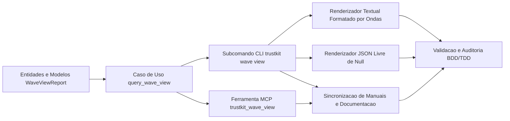

# Especificacao: 010-wave-view-cli-inspection

## 1. Product Trio

- **PM**: Atualmente, a visualizacao da hierarquia e do agrupamento de tarefas em ondas de execucao requer a execucao de queries manuais em `.trustkit/state.db` ou o reprocessamento de planejamento via `trustkit wave plan`. O TRustKit deve fornecer um comando dedicado de inspecao passiva `trustkit wave view` que consulte deterministicamente o ciclo ativo e suas tarefas persistidas, exibindo no terminal o detalhamento estruturado das ondas com status TDD e worktree de cada tarefa (reproduzindo exatamente o formato de agrupamento em ondas), alem de suportar exportacao JSON limpa livre de `null`. Ademais, toda a documentacao de apoio do projeto, manuais, guias e READMEs devem ser revisados e sincronizados de forma cirurgica e estrita conforme necessario.
- **Tech Lead**: Extensao hexagonal nos crates `trustkit-core`, `trustkit-cli` e `trustkit-orch` (MCP). No `trustkit-core`, implementar o caso de uso `query_wave_view` consumindo `CycleEvidenceRepositoryPort` para resgatar o ciclo ativo e `list_atomic_tasks`, agrupando as tarefas ordenadas por `wave_index` e `task_id` em um modelo de dominio imutavel `WaveViewReport`. No `trustkit-cli`, adicionar o subcomando `trustkit wave view [--cycle-id <ID>] [--json]` com renderizador textual identico a secao estruturada de ondas e renderizador JSON. No `trustkit-orch`, expor a ferramenta MCP `trustkit_wave_view`. Realizar a revisao e atualizacao cirurgica dos artefatos de documentacao (`README.md`, `README.en.md`, `.agents/skills/trustkit-sdd/SKILL.md` e manuais de CLI) refletindo o novo subcomando e tool MCP.
- **Design / QA**: Crie testes unitarios e de integracao validando que `trustkit wave view` executa em menos de 10ms, preserva o contrato estrito de ordenacao por onda e tarefa, renderiza com fidelidade o status TDD de cada tarefa, respeita 100% a politica de zero emojis, zero panics e tipos livres de valores nulos. Garantir verificacao cruzada de documentacao sem drifts conceituais.

## 2. Diagrama de Fluxo (Mermaid)

## 3. Criterios de Aceitacao (Gherkin)

### Cenario 1: Modelagem de Dominio para Inspecao de Ondas (Atendimento de RF-062)

- **Dado** que o crate `trustkit-core` define os modelos de consulta de ciclo e tarefas
- **Quando** a requisicao `QueryWaveViewRequest` for processada pelo caso de uso `query_wave_view`
- **Entao** o modelo de saida `WaveViewReport` e suas entidades aninhadas (`WaveViewItem`, `TaskViewItem`) sao construidos utilizando tipos estritos de `std`, 100% livres de valores nulos e sem violar o isolamento hexagonal.

### Cenario 2: Agrupamento Deterministico e Mapeamento de Status (Atendimento de RF-063)

- **Dado** um ciclo ativo registrado no banco SQLite WAL (`.trustkit/state.db`) com tarefas distribuidas em multiplas ondas
- **Quando** o caso de uso `query_wave_view` consultar as tarefas atomicas persistidas
- **Entao** as tarefas sao agrupadas por `wave_index` crescente, ordenadas internamente por `task_id` alfanumerico e expõem `task_id`, `architectural_layer`, `title`, lista de dependencias (`depends_on`) e status do ciclo TDD (`tdd_lifecycle_state`).

### Cenario 3: Subcomando CLI `trustkit wave view` e Saida Textual Formatada (Atendimento de RF-064)

- **Dado** que o desenvolvedor ou agente executa `trustkit wave view` no terminal
- **Quando** houver um ciclo ativo e tarefas registradas
- **Entao** o comando emite no stdout a saida textual formatada exatamente no padrao de ondas:
  - Cabecalho identificando o ciclo e a especificacao associada;
  - Resumo de total de ondas e total de tarefas;
  - Blocos por onda (`Wave N (descricao/dependencia):`);
  - Itens de tarefa com identificador, camada, titulo, lista de dependencias e estado TDD;
  - Rodape mandatorio de orientacao `NEXT STEP:`.

### Cenario 4: Suporte a Modo `--json` Deterministo e Livre de Null (Atendimento de RF-065)

- **Dado** que a flag `--json` e fornecida na chamada `trustkit wave view --json`
- **Quando** o payload JSON de resposta for serializado
- **Entao** todos os campos opcionais ausentes sao omitidos ou serializados com tipos sentinela (vetores vazios ou enums explicitos), proibindo a presenca de literais `null` no JSON.

### Cenario 5: Tratamento Gracioso de Ciclos sem Ondas Planejadas (Atendimento de RF-066)

- **Dado** um ciclo ativo que ainda nao passou pelo Gate 3 (`trustkit wave plan`) ou nao possui tarefas cadastradas
- **Quando** `trustkit wave view` for executado
- **Entao** o comando retorna erro semantico `DomainViolation::PreconditionNotMet` ou mensagem amigavel indicando que o planejamento de ondas deve ser executado previamente, sem provocar panic ou unwrap falho.

### Cenario 6: Exposicao de Ferramenta MCP `trustkit_wave_view` (Atendimento de RF-067)

- **Dado** o servidor MCP nativo rodando via `trustkit mcp serve`
- **Quando** um agente de desenvolvimento ou orquestrador invocar a tool `trustkit_wave_view` via JSON-RPC 2.0
- **Entao** o servidor MCP retorna a estrutura completa das ondas do ciclo ativo com tempo de resposta inferior a 10ms.

### Cenario 7: Revisao e Atualizacao Cirurgica da Documentacao de Apoio e Manuais (Atendimento de RF-068)

- **Dado** a introducao do subcomando `trustkit wave view` e da ferramenta MCP `trustkit_wave_view`
- **Quando** a entrega da funcionalidade for finalizada
- **Entao** toda a documentacao de apoio do projeto (`README.md`, `README.en.md`, manuais da CLI e guias da Thin Skill `.agents/skills/trustkit-sdd/SKILL.md`) deve ser revisada e atualizada exclusivamente nos pontos pertinentes para documentar a sintaxe, flags (`--json`, `--cycle-id`), exemplos de saida e casos de uso de inspecao de ondas, mantendo paridade bilingue e zero emojis.

## 4. Matriz de Rastreabilidade

| Regra de Negocio | Requisito Funcional | Tarefa | No do Grafo | Teste Alvo | Evidencia |
| :--- | :--- | :--- | :--- | :--- | :--- |
| RN-001 | RF-062 | TASK-001 | Node1 | crates/trustkit-core/tests/wave_view_entities_tests.rs | EV-001-wave-view-entities.json |
| RN-002 | RF-063 | TASK-002 | Node2 | crates/trustkit-core/tests/query_wave_view_use_case_tests.rs | EV-002-query-wave-view-use-case.json |
| RN-003 | RF-064 | TASK-003 | Node3 | crates/trustkit-cli/tests/cli_wave_view_cmd_tests.rs | EV-003-cli-wave-view-cmd.json |
| RN-004 | RF-065 | TASK-004 | Node5 | crates/trustkit-cli/tests/cli_wave_view_json_tests.rs | EV-004-cli-wave-view-json.json |
| RN-005 | RF-066 | TASK-005 | Node2 | crates/trustkit-core/tests/wave_view_empty_cycle_tests.rs | EV-005-wave-view-empty-cycle.json |
| RN-006 | RF-067 | TASK-006 | Node4 | crates/trustkit-orch/tests/mcp_wave_view_tool_tests.rs | EV-006-mcp-wave-view-tool.json |
| RN-007 | RF-068 | TASK-007 | Node7 | crates/trustkit-ast/tests/skill_wave_view_docs_tests.rs | EV-007-wave-view-docs-sync.json |
