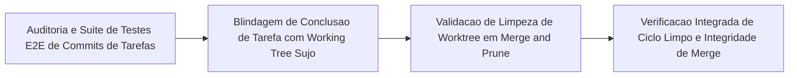

# Especificacao: validar-ciclo-de-commits-de-tarefas-e-integridade-do-merge-local-em-ciclos-sdd

## 1. Product Trio

- **PM**: Desenvolvedores e agentes relatam que, apos realizarem multiplos ciclos SDD e completarem tarefas, ao tentar realizar o merge ou encerramento de ciclo, o Git alerta sobre alteracoes nao commitadas ou falhas de integracao. A hipotese central e que tarefas estao avancando para o estado Committed no SQLite sem que commits Git atomicos reais tenham sido efetivados no repositorio da worktree ou no branch de trabalho, ou que arquivos sujos (uncommitted / unstaged) estejam sendo deixados para tras sem aviso previo ate a etapa de merge. A solucao blinda a transicao de conclusao de tarefas e o procedimento de merge de worktree para impedir estados inconsistentes.
- **Tech Lead**: Em `crates/trustkit-cli/src/commands/task_cmd.rs` e `crates/trustkit-core/src/use_cases/complete_task.rs`, auditar o estado do Git via `git status --porcelain` no diretorio de trabalho da tarefa, recusando a conclusao com `DomainViolation` clara caso existam arquivos nao commitados e assegurando que o `commit_sha` gravado corresponda a um commit recente contendo as alteracoes. Em `crates/trustkit-orch/src/worktree_provider.rs`, garantir que `merge_and_prune_worktree` valide a limpeza da worktree antes de executar o merge na branch alvo. Construir testes E2E e de integracao em `crates/trustkit-cli` e `crates/trustkit-orch` que reproduzam cenarios de working tree sujo e commits pendentes.
- **Design / QA**: Garantir 100% de cobertura de testes automatizados comprovando que `trustkit task complete` rejeita a conclusao com working tree sujo, que `merge_and_prune_worktree` rejeita o merge se houver arquivos modificados nao commitados na worktree, que tarefas com commits validos avancam com sucesso e que nenhuma alteracao orfa de arquivo e deixada para tras ao concluir tarefas ou encerrar ciclos.

## 2. Diagrama de Fluxo (Mermaid)

## 3. Criterios de Aceitacao (Gherkin)

### Cenario 1: Rejeicao de conclusao de tarefa quando ha arquivos modificados nao commitados (Atendimento de RF-001)

- **Dado** uma tarefa atomica ativa em execucao com alteracoes locais pendentes no working tree
- **Quando** o comando `trustkit task complete` for executado sem que um commit Git tenha sido realizado
- **Entao** a operacao falha deterministicamente com violacao de dominio e o estado da tarefa permanece nao concluido no SQLite.

### Cenario 2: Rejeicao de merge e prune em worktree com alteracoes locais nao commitadas (Atendimento de RF-002)

- **Dado** uma worktree provisionada para uma tarefa atomica contendo arquivos modificados ou nao rastreados
- **Quando** o provedor de isolamento tentar executar `merge_and_prune_worktree` para a branch alvo
- **Entao** o procedimento falha imediatamente com erro semantico impedindo a perda de arquivos ou contaminacao da branch alvo.

### Cenario 3: Conclusao bem-sucedida de tarefa com commit valido e working tree limpo (Atendimento de RF-003)

- **Dado** uma tarefa atomica com todas as alteracoes devidamente commitadas e working tree limpo
- **Quando** o comando `trustkit task complete` for executado
- **Entao** o SHA do commit recente e registrado com sucesso no SQLite e o estado da tarefa avanca para Committed.

### Cenario 4: Integracao E2E do ciclo de tarefas sem alteracoes orfas e integridade de merge (Atendimento de RF-004)

- **Dado** uma suite de testes de integracao simulando o ciclo de vida completo de tarefas
- **Quando** todas as fases TDD, commits atomicos e merges forem processados
- **Entao** todos os testes passam sem deixar arquivos orfaos e a branch de trabalho reflete com precisao o historico linear.

## 4. Matriz de Rastreabilidade

| Regra Negocio | Requisito Funcional | Tarefa | No Mermaid | Teste Unitario / Integracao | Evidencia / Verificacao |
| :--- | :--- | :--- | :--- | :--- | :--- |
| RN-001 | RF-001 | TASK-001 | Node1 | crates/trustkit-cli/tests/task_complete_dirty_guard_tests.rs | EV-001-task-complete-dirty-rejected.json |
| RN-002 | RF-002 | TASK-002 | Node2 | crates/trustkit-orch/tests/worktree_merge_dirty_guard_tests.rs | EV-002-worktree-merge-dirty-rejected.json |
| RN-003 | RF-003 | TASK-003 | Node3 | crates/trustkit-cli/tests/task_complete_clean_commit_tests.rs | EV-003-task-complete-clean-accepted.json |
| RN-004 | RF-004 | TASK-004 | Node4 | crates/trustkit-cli/tests/e2e_task_lifecycle_commit_integrity_tests.rs | EV-004-e2e-commit-integrity-cycle.json |
