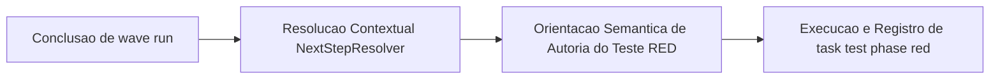

# Especificacao: fix-sdd-lacuna-no-fluxo-entre-wave-run-e-task-test-phase-red-quando-teste-ainda-nao-existe

## 1. Product Trio

- **PM**: Em fluxos SDD (em especial na execucao em modo nativo ou cooperativo sem agente autonomo), a transicao entre `wave run` e `task test --phase red` apresenta uma lacuna procedimental e cognitiva. O resolvedor de proximos passos direciona o desenvolvedor imediatamente a rodar `trustkit task test <task_id> --phase red` antes que qualquer teste tenha sido escrito no arquivo alvo. Quando o `target_test_file` ja contem testes anteriores que passam, a execucao imediata obtem saida zero e dispara violacao de ciclo TDD (`TDD_VIOLATION`); quando nao existe ou nao compila, dispara falhas de compilacao. A solucao instrui expressamente no `NextStepResolver` e no `Presenter` a concepcao e escrita do teste falhando antes do registro RED, fornece diagnostico acionavel e atualiza a skill `trustkit-sdd` para explicitar a etapa de autoria no fluxo de trabalho.
- **Tech Lead**: No crate `trustkit-core`, refinar `NextStepResolver::for_wave_run` e `NextStepStatusPolicy` para que as recomendacoes de tarefas pendentes em `AwaitingRed` explicitem a escrita/adicao da assercao falhando no `target_test_file` antes de validar a fase RED. Em `trustkit-cli`, aprimorar o diagnostico em `task_cmd` para instruir o desenvolvedor com mensagem semantica clara e acionavel caso a suite passe sem nenhuma falha comprovada. Atualizar a documentacao da skill `trustkit-sdd` formalizando a etapa de confeccao do teste RED entre a inicializacao da onda e a checagem da fase RED.
- **Design / QA**: Garantir via testes unitarios e de integracao que o `NextStepResolver` emita recomendacoes precisas e livres de campos nulos em JSON, que o fluxo previna falsos positivos de TDD, e que a jornada de desenvolvimento no Gate 4 permaneca deterministica, sem emojis e sem trailers de IA.

## 2. Diagrama de Fluxo (Mermaid)

## 3. Criterios de Aceitacao (Gherkin)

### Cenario 1: Orientacao explicita de autoria de teste no NextStepResolver para wave run (Atendimento de RF-001)

- **Dado** uma onda executada com tarefas pendentes em estado AwaitingRed
- **Quando** o NextStepResolver calcular as recomendacoes de proximo passo para wave run
- **Entao** a descricao da recomendacao primaria orienta expressamente o desenvolvedor a redigir a assercao de teste falhando no target_test_file antes de rodar o comando task test phase red.

### Cenario 2: Orientacao contextual no NextStepStatusPolicy ao consultar status (Atendimento de RF-002)

- **Dado** um ciclo ativo com tarefa pendente aguardando a fase RED
- **Quando** a politica de proximo passo de status for calculada
- **Entao** o proximo passo orienta a escrita do teste falhando no arquivo de teste alvo.

### Cenario 3: Diagnostico acionavel em task test phase red quando a suite passa sem falhas (Atendimento de RF-003)

- **Dado** um target_test_file pre-existente cujos testes executados passam com codigo de saida zero
- **Quando** o comando trustkit task test TASK-XXX --phase red for executado
- **Entao** o erro TDD_VIOLATION inclui orientacao remediadora clara para adicionar um teste que comprove a falha do novo comportamento antes de prosseguir.

### Cenario 4: Alinhamento de instrucoes na skill trustkit-sdd (Atendimento de RF-004)

- **Dado** a secao do Gate 4 na documentacao da skill trustkit-sdd
- **Quando** o agente ou desenvolvedor consultar o fluxo recomendado
- **Entao** a documentacao explicita a etapa de autoria do teste falhando entre o provisionamento de worktree e a verificacao da fase RED.

## 4. Matriz de Rastreabilidade

| Regra Negocio | Requisito Funcional | Tarefa | No Mermaid | Teste Unitario / Integracao | Evidencia / Verificacao |
| :--- | :--- | :--- | :--- | :--- | :--- |
| RN-001 | RF-001 | TASK-001 | Node1 | crates/trustkit-core/src/next_step_guidance_tests.rs | EV-001-wave-run-next-step-red-guidance.json |
| RN-002 | RF-002 | TASK-002 | Node2 | crates/trustkit-core/src/next_step_status_policy_tests.rs | EV-002-status-policy-red-authoring.json |
| RN-003 | RF-003 | TASK-003 | Node3 | crates/trustkit-cli/tests/cli_task_test_red_guidance_tests.rs | EV-003-task-test-red-diagnostic.json |
| RN-004 | RF-004 | TASK-004 | Node4 | tests/skill_guidance_tests.rs | EV-004-skill-flow-alignment.json |
