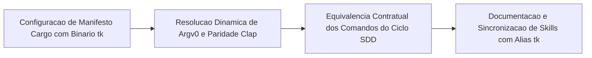

# Especificacao: suporte-ao-binario-abreviado-tk-como-alias-equivalente-para-trustkit

## 1. Product Trio

- **PM**: Em rotinas continuas de desenvolvimento orientado a especificacoes (SDD), TDD e operacoes no terminal, desenvolvedores e agentes executam dezenas de vezes comandos como `trustkit task test`, `trustkit wave run`, `trustkit status` e `trustkit doctor`. A adocao da forma abreviada e ergonomica `tk` (ex: `tk task test`, `tk status`, `tk auto`) reduz sensivelmente a sobrecarga de digitacao no terminal, preservando paridade estrita e comportamento 100% identico ao comando original, mantendo contratos JSON imutaveis e compativel com instalacoes de ambiente.
- **Tech Lead**: No crate `trustkit-cli`, configurar o manifesto Cargo para expor a definicao binaria adicional `[[bin]] name = "tk"` apontando para o ponto de entrada `src/main.rs`. Adequar o despachante e o parser do Clap para que a resolucao de argumentos, documentacao de help e versao operem de forma consistente independente de `argv[0]` ser `trustkit` ou `tk`. Assegurar que os testes de contrato e integracao comprovem paridade total entre `tk` e `trustkit` e que as skills documentem a utilizacao ergonomica do alias.
- **Design / QA**: Garantir via testes automatizados de contrato que `tk --help`, `tk --version`, `tk status` e `tk doctor` operem com codigo de saida zero, sem erros de terminal, com formatacao identica e sem qualquer regressao em contratos JSON existentes. Assegurar conformidade absoluta com as regras constitucionais: zero emojis, zero trailers de autoria IA e TDD estrito com RED comprovado antes de GREEN.

## 2. Diagrama de Fluxo (Mermaid)

## 3. Criterios de Aceitacao (Gherkin)

### Cenario 1: Compilacao e geracao dos binarios trustkit e tk pelo Cargo (Atendimento de RF-001)

- **Dado** o manifesto Cargo do crate trustkit-cli configurado com as entradas binarias trustkit e tk
- **Quando** o comando cargo build for executado no workspace
- **Entao** ambos os binarios target/debug/trustkit e target/debug/tk sao gerados com sucesso no diretorio de destino.

### Cenario 2: Resolucao dinamica de argv0 e exibicao de help e versao correspondentes (Atendimento de RF-002)

- **Dado** o binario tk executado no terminal com as flags --help e --version
- **Quando** o parser de linha de comando processar os argumentos com base em argv0
- **Entao** o retorno exibe codigo de saida zero com o nome de invocacao correspondente preservando compatibilidade sem panics.

### Cenario 3: Equivalencia contratual entre comandos executados via trustkit e tk (Atendimento de RF-003)

- **Dado** qualquer subcomando do ciclo SDD como status, doctor ou task
- **Quando** o subcomando for invocado via tk ou trustkit tanto em modo texto quanto em modo json
- **Entao** a resposta, codigo de saida, veredito e contrato JSON emitidos sao estritamente equivalentes.

### Cenario 4: Documentacao do alias tk nos guias tecnicos e skills SDD (Atendimento de RF-004)

- **Dado** os documentos de instrucao técnica e as definicoes de skills do TRustKit SDD
- **Quando** o desenvolvedor ou agente consultar os comandos recomendados
- **Entao** a documentacao orienta explicitamente a disponibilidade e equivalencia do binario abreviado tk como alias oficial.

## 4. Matriz de Rastreabilidade

| Regra Negocio | Requisito Funcional | Tarefa | No Mermaid | Teste Unitario / Integracao | Evidencia / Verificacao |
| :--- | :--- | :--- | :--- | :--- | :--- |
| RN-001 | RF-001 | TASK-001 | Node1 | crates/trustkit-cli/tests/tk_cargo_binary_manifest_tests.rs | EV-001-tk-cargo-binary-manifest.json |
| RN-002 | RF-002 | TASK-002 | Node2 | crates/trustkit-cli/tests/tk_cli_parity_tests.rs | EV-002-tk-cli-parity.json |
| RN-003 | RF-003 | TASK-003 | Node3 | crates/trustkit-cli/tests/tk_subcommands_contract_tests.rs | EV-003-tk-subcommands-contract.json |
| RN-004 | RF-004 | TASK-004 | Node4 | crates/trustkit-cli/tests/tk_doc_and_skills_sync_tests.rs | EV-004-tk-doc-and-skills-sync.json |
