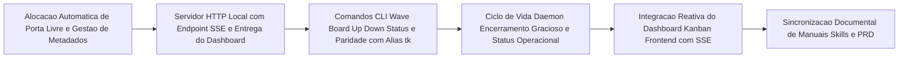

# Especificacao: servico-de-kanban-board-em-tempo-real-via-trustkit-wave-board-up-down

## 1. Product Trio

- **PM**: Acompanhar visualmente a governanca deterministica de Spec-Driven Development (SDD) e a execucao paralela de ondas de tarefas em Git Worktrees demanda um servico local integrado a CLI (`trustkit wave board` e o alias equivalente `tk wave board`). O servico deve inicializar com alocacao 100% automatica de porta TCP livre, sem exigir intervencao manual do operador ou adivinhacao de portas disponiveis. O painel kanban deve refletir em tempo real (via Server-Sent Events - SSE) os avancos entre os 7 Gates, o status de TDD (RED para GREEN), metricas do Gauntlet V2 e selos BLAKE3 a partir do SQLite WAL, oferecendo suporte aos comandos `up`, `down` e `status` com paridade estrita entre os binarios e documentacao integralmente atualizada.
- **Tech Lead**: No crate `trustkit-orch`, implementar a deteccao dinamica de portas TCP livres via `TcpListener::bind("127.0.0.1:0")`, a gestao do ciclo de vida do processo daemon com persistencia de metadados em `.trustkit/wave-board.json` (pid, port, url, started_at) e o servidor HTTP leve assincrono com endpoint SSE `/events` conectado a FSM e ao `.trustkit/state.db`. No crate `trustkit-cli`, estender `WaveSubcommand` para incorporar o subcomando `Board` com variantes `Up`, `Down` e `Status`, garantindo que ambos `trustkit` e `tk` entreguem respostas TTY ergonomicas com footer contextual de proximo passo e saida JSON deterministica null-free (`--json`). No dashboard frontend (`docs/prototypes/trustkit-kanban-dashboard.html`), conectar automaticamente ao stream SSE para atualizacao reativa dos cards. Atualizar rigorosamente os manuais do usuario em Markdown e HTML, o guia de skills do SDD, o README e o PRD.
- **Design / QA**: Garantir conformidade com os padroes constitucionais do TRustKit: zero emojis, zero trailers de autoria IA, TDD estrito com assercoes de dominio comprovadas (fases RED antes de GREEN) e saida estruturada null-free. Assegurar testes unitarios e de integracao cobrindo alocacao dinamica de portas livres sem conflito, inicializacao e encerramento gracioso do daemon, paridade de comandos entre `trustkit` e `tk`, emissao de eventos SSE e verificacao de sincronismo documental.

## 2. Diagrama de Fluxo (Mermaid)

## 3. Criterios de Aceitacao (Gherkin)

### Cenario 1: Alocacao automatica de porta livre e gravacao de metadados (Atendimento de RF-001)

- **Dado** o comando de inicializacao do board acionado sem configuracao manual de porta
- **Quando** o servico de deteccao de porta dinamicamente ligar o socket em 127.0.0.1 com porta efemera
- **Entao** o sistema aloca uma porta TCP livre, grava os metadados em .trustkit/wave-board.json e disponibiliza a URL final pronta para conexao.

### Cenario 2: Servidor HTTP local com streaming SSE reativo (Atendimento de RF-002)

- **Dado** o daemon do wave board em execucao local
- **Quando** o cliente web acessar a rota raiz ou se conectar ao endpoint de eventos /events
- **Entao** o servidor entrega a interface HTML do dashboard kanban e transmite notificacoes de mutacao de estado originadas no banco SQLite WAL via Server-Sent Events.

### Cenario 3: Execucao ergonomica dos comandos via trustkit e tk (Atendimento de RF-003)

- **Dado** o operador executando os subcomandos wave board up, down ou status no terminal
- **Quando** o comando for invocado indistintamente via trustkit ou pelo alias abreviado tk em modo texto ou com a flag --json
- **Entao** a resposta terminal apresenta equivalencia comportamental estrita com recomendacao de proximo passo em modo TTY e contrato JSON livre de valores nulos.

### Cenario 4: Encerramento gracioso e consulta de status do servico (Atendimento de RF-004)

- **Dado** um servico de board previamente inicializado e com metadados persistidos
- **Quando** o comando wave board down for executado ou wave board status for consultado
- **Entao** o status informa PID, porta e tempo de atividade com precisao, e o encerramento envia sinal de desligamento gracioso removendo o arquivo de metadados.

### Cenario 5: Atualizacao reativa no dashboard kanban via SSE (Atendimento de RF-005)

- **Dado** o dashboard kanban aberto e conectado ao stream SSE do servidor local
- **Quando** agentes executarem mutacoes de ciclo, transicoes de gates ou mudancas de fase TDD
- **Entao** a interface do dashboard reflete imediatamente a mudanca nos cards correspondentes sem necessidade de recarregamento manual da pagina.

### Cenario 6: Sincronismo documental e guias de skills (Atendimento de RF-006)

- **Dado** a entrega da funcionalidade de monitoramento do kanban board
- **Quando** a suite de verificacao documental auditar os manuais e skills
- **Entao** o manual do usuario em Markdown e HTML, a skill trustkit-sdd, o README e o PRD contem a documentacao completa da sintaxe wave board e do alias tk.

## 4. Matriz de Rastreabilidade

| Regra Negocio | Requisito Funcional | Tarefa | No Mermaid | Teste Unitario / Integracao | Evidencia / Verificacao |
| :--- | :--- | :--- | :--- | :--- | :--- |
| RN-001 | RF-001 | TASK-001 | Node1 | crates/trustkit-orch/tests/wave_board_port_allocator_tests.rs | EV-001-wave-board-port-allocator.json |
| RN-002 | RF-002 | TASK-002 | Node2 | crates/trustkit-orch/tests/wave_board_server_sse_tests.rs | EV-002-wave-board-server-sse.json |
| RN-003 | RF-003 | TASK-003 | Node3 | crates/trustkit-cli/tests/wave_board_cli_commands_tests.rs | EV-003-wave-board-cli-commands.json |
| RN-004 | RF-004 | TASK-004 | Node4 | crates/trustkit-orch/tests/wave_board_lifecycle_shutdown_tests.rs | EV-004-wave-board-lifecycle-shutdown.json |
| RN-005 | RF-005 | TASK-005 | Node5 | crates/trustkit-orch/tests/wave_board_dashboard_sse_client_tests.rs | EV-005-wave-board-dashboard-sse-client.json |
| RN-006 | RF-006 | TASK-006 | Node6 | crates/trustkit-cli/tests/wave_board_documentation_sync_tests.rs | EV-006-wave-board-documentation-sync.json |
