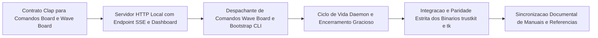

# Especificacao: integracao-e-despacho-dos-subcomandos-board-e-wave-board-no-clap-e-background-daemon

## 1. Product Trio

- **PM**: Operadores necessitam acompanhar em tempo real o progresso do desenvolvimento orientado a especificacoes (SDD) e a execucao paralela de ondas de tarefas. A linha de comando deve fornecer os comandos ergonomicos `trustkit board` e `trustkit wave board` (com suporte identico ao alias oficial `tk`), contemplando as acoes `up`, `down` e `status`. A acao `up` deve inicializar o servidor em segundo plano alocando porta TCP livre automaticamente, registrar os metadados em `.trustkit/wave-board.json`, suportar a flag `--open` para acionar o navegador padrao, e exibir instrucoes com recomendacao de proximo passo em modo TTY e contrato JSON livre de valores nulos em modo `--json`.
- **Tech Lead**: No crate `trustkit-cli`, estender o contrato Clap em `cli_contract.rs` para incluir o comando raiz `Board` e o subcomando `Board` dentro de `WaveSubcommand`, implementando as estruturas `BoardArgs`, `WaveBoardArgs` e seus despachantes em `commands/wave_board_cmd.rs` e `bootstrap.rs`. No crate `trustkit-orch`, estender `WaveBoardServerSse` para hospedar o servidor HTTP real servindo a interface `docs/prototypes/trustkit-kanban-dashboard.html` na rota `/` e transmitindo Server-Sent Events na rota `/events`. Aprimorar `WaveBoardLifecycleManager` para encerramento confiavel de processos daemon via sinais de termino.
- **Design / QA**: Garantir total conformidade com as regras constitucionais: zero emojis em todas as saidas e arquivos, zero trailers de autoria IA em commits e codigos, ciclo TDD estrito com RED comprovado antes de GREEN, e paridade estrita de argumentos e respostas entre os binarios `trustkit` e `tk`.

## 2. Diagrama de Fluxo (Mermaid)

## 3. Criterios de Aceitacao (Gherkin)

### Cenario 1: Contrato Clap e parsing para board e wave board (Atendimento de RF-001)

- **Dado** o operador invocando subcomandos board ou wave board com up, down ou status
- **Quando** o Clap processar os argumentos da linha de comando
- **Entao** os argumentos sao mapeados para a estrutura de dados correta com suporte as flags --open e --json.

### Cenario 2: Servidor HTTP local com SSE e entrega de dashboard (Atendimento de RF-002)

- **Dado** o servidor HTTP de wave board instanciado com o dashboard HTML
- **Quando** clientes HTTP requisitarem a rota raiz ou o endpoint de eventos /events
- **Entao** a rota raiz retorna o HTML com Content-Type text/html e a rota /events transmite eventos de mutacao via Server-Sent Events.

### Cenario 3: Despachante e manipulador de comandos board (Atendimento de RF-003)

- **Dado** o comando board up acionado pelo operador
- **Quando** o despachante executar o comando
- **Entao** a porta TCP efemera e alocada, o processo daemon e disparado em segundo plano, os metadados sao gravados em .trustkit/wave-board.json e a resposta formatada e apresentada no terminal.

### Cenario 4: Ciclo de vida daemon e encerramento gracioso (Atendimento de RF-004)

- **Dado** o daemon do wave board em execucao com metadados persistidos
- **Quando** o comando board down for acionado ou board status for consultado
- **Entao** o status exibe PID, porta, URL e tempo de atividade, e o encerramento envia sinal de desligamento ao processo e remove o arquivo de metadados.

### Cenario 5: Paridade estrita entre os binarios trustkit e tk (Atendimento de RF-005)

- **Dado** os comandos board e wave board executados via trustkit ou pelo alias tk
- **Quando** os comandos forem processados em modo TTY ou com a flag --json
- **Entao** ambos os binarios entregam comportamento identico com bloco NEXT STEP em TTY e JSON valido livre de valores nulos.

### Cenario 6: Sincronismo documental de manuais e referencias (Atendimento de RF-006)

- **Dado** as novas capacidades dos subcomandos board e wave board
- **Quando** a suite de verificacao documental inspecionar a base
- **Entao** os manuais do usuario e as skills de governanca contem a documentacao da sintaxe e opcoes dos comandos.

## 4. Matriz de Rastreabilidade

| Regra Negocio | Requisito Funcional | Tarefa | No Mermaid | Teste Unitario / Integracao | Evidencia / Verificacao |
| :--- | :--- | :--- | :--- | :--- | :--- |
| RN-001 | RF-001 | TASK-001 | Node1 | crates/trustkit-cli/tests/wave_board_clap_contract_tests.rs | EV-001-wave-board-clap-contract.json |
| RN-002 | RF-002 | TASK-002 | Node2 | crates/trustkit-orch/tests/wave_board_http_server_tests.rs | EV-002-wave-board-http-server.json |
| RN-003 | RF-003 | TASK-003 | Node3 | crates/trustkit-cli/tests/wave_board_command_dispatcher_tests.rs | EV-003-wave-board-command-dispatcher.json |
| RN-004 | RF-004 | TASK-004 | Node4 | crates/trustkit-orch/tests/wave_board_lifecycle_daemon_tests.rs | EV-004-wave-board-lifecycle-daemon.json |
| RN-005 | RF-005 | TASK-005 | Node5 | crates/trustkit-cli/tests/wave_board_e2e_parity_tests.rs | EV-005-wave-board-e2e-parity.json |
| RN-006 | RF-006 | TASK-006 | Node6 | crates/trustkit-cli/tests/wave_board_documentation_sync_tests.rs | EV-006-wave-board-documentation-sync.json |
