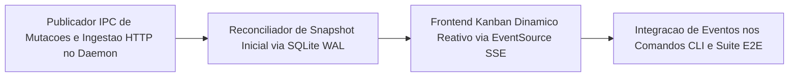

# Especificacao: sincronizacao-em-tempo-real-do-wave-board-com-sqlite-wal-executor-de-ondas-e-streaming-dinamico-via-sse

## 1. Product Trio

- **PM**: Operadores acompanhando ciclos reais de Spec-Driven Development (SDD) precisam que o Wave Board (`trustkit board` / `tk board`) reflita fielmente o estado persistido no banco SQLite WAL (`.trustkit/state.db`), eliminando a dependencia de cards de demonstracao estaticos. Toda execucao de comandos de ciclo, planejamento de ondas (`tk wave run`), testes TDD (`tk task test <TASK_ID> --phase red/green`) e conclusao de tarefas (`tk task complete`) deve atualizar dinamicamente o quadro kanban em tempo real via Server-Sent Events (`/events`), mantendo desacoplamento gracioso caso o daemon nao esteja ativo.
- **Tech Lead**: No crate `trustkit-orch`, implementar `WaveBoardEventPublisher` para despacho IPC nao-bloqueante via HTTP (`POST /api/events`) quando `.trustkit/wave-board.json` existir, e `WaveBoardSnapshotBuilder` para consolidar ciclos e tarefas atomicas do SQLite WAL em snapshots JSON estritamente tipados e livres de valores nulos (`GET /api/snapshot` e evento inicial `snapshot` em `GET /events`). No frontend `docs/prototypes/trustkit-kanban-dashboard.html`, integrar `EventSource('/events')`, limpar cards estaticos, renderizar o snapshot real e processar mutacoes incrementais entre as colunas dos Gates 0 a 6 com indicador de conectividade. No crate `trustkit-cli`, acoplar a emissao de eventos nos comandos de tarefas e ondas.
- **Design / QA**: Garantir conformidade irrestrita com os invariantes constitucionais: zero emojis em codigos, interfaces, documentacao e commits; zero trailers de autoria IA; ciclo TDD estrito com fase RED comprovada antes da fase GREEN; isolamento hexagonal entre `trustkit-db`, `trustkit-orch` e `trustkit-cli`; e ausencia absoluta de valores `null` nos contratos JSON.

## 2. Diagrama de Fluxo (Mermaid)

## 3. Criterios de Aceitacao (Gherkin)

### Cenario 1: Ingestao e despacho de eventos IPC entre CLI e daemon (Atendimento de RF-001)

- **Dado** o servidor do Wave Board ativo com endpoint de ingestao de eventos e canal broadcast SSE
- **Quando** um publicador IPC enviar uma mutacao de card ou o daemon nao estiver ativo no ambiente
- **Entao** o daemon ativo transmite o frame SSE de mutacao aos clientes conectados e a ausencia do daemon e ignorada graciosamente sem erros.

### Cenario 2: Carregamento do estado real inicial via snapshot do SQLite WAL (Atendimento de RF-002)

- **Dado** o daemon do Wave Board em execucao com ciclos e tarefas reais persistidos no SQLite WAL
- **Quando** um cliente requisitar o endpoint /api/snapshot ou conectar ao stream /events
- **Entao** o servidor retorna o snapshot consolidado livre de valores nulos contendo os cards reais, gates, fases TDD, hashes BLAKE3 e comandos recomendados.

### Cenario 3: Renderizacao dinamica e transicao reativa de colunas no frontend (Atendimento de RF-003)

- **Dado** o frontend do dashboard kanban conectado ao servidor via EventSource em /events
- **Quando** o evento de snapshot inicial ou mutacoes incrementais de fases TDD e gates forem recebidos
- **Entao** o frontend remove os cards estaticos de demonstracao, renderiza os cards reais, move os cards entre as colunas de Gates 0 a 6 e atualiza badges e contadores sem recarregar a pagina.

### Cenario 4: Sincronizacao ponta a ponta nos comandos CLI e desacoplamento gracioso (Atendimento de RF-004)

- **Dado** um ciclo SDD ativo executando transicoes via tk task test, tk task complete e tk wave run
- **Quando** o estado for persistido no SQLite com o Wave Board ativo ou parado
- **Entao** com o board ativo os eventos sao entregues em tempo real via SSE e com o board parado os comandos concluem normalmente com exit code 0.

## 4. Matriz de Rastreabilidade

| Regra Negocio | Requisito Funcional | Tarefa | No Mermaid | Teste Unitario / Integracao | Evidencia / Verificacao |
| :--- | :--- | :--- | :--- | :--- | :--- |
| RN-001 | RF-001 | TASK-001 | Node1 | crates/trustkit-orch/tests/wave_board_ipc_event_ingestion_tests.rs | EV-001-wave-board-ipc-event-ingestion.json |
| RN-002 | RF-002 | TASK-002 | Node2 | crates/trustkit-orch/tests/wave_board_sqlite_snapshot_tests.rs | EV-002-wave-board-sqlite-snapshot.json |
| RN-003 | RF-003 | TASK-003 | Node3 | crates/trustkit-orch/tests/wave_board_dynamic_frontend_tests.rs | EV-003-wave-board-dynamic-frontend.json |
| RN-004 | RF-004 | TASK-004 | Node4 | crates/trustkit-cli/tests/wave_board_realtime_cli_e2e_tests.rs | EV-004-wave-board-realtime-cli-e2e.json |
