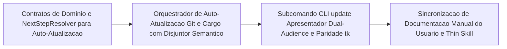

# Especificacao: subcomando-de-auto-atualizacao-trustkit-update-e-tk-update

## 1. Product Trio

- **PM**: Desenvolvedores e agentes autonomos precisam de um subcomando nativo `trustkit update` (e seu alias `tk update`) que verifique, compile e atualize os binarios a partir da branch remota `main` do repositorio oficial (`mymakecoins/TRustKit`), eliminando passos manuais propensos a falhas e reduzindo atritos operacionais.
- **Tech Lead**: Definir os contratos puros de dominio e orientacao contextual (`NextStepResolver::for_update`) em `trustkit-core`, implementar o orquestrador `SelfUpdateOrchestrator` em `trustkit-orch` suportando verificacao `--check`, reconstrucao forcada `--force`, fluxo em repositorio fonte, fallback via `cargo install --git` e disjuntor semantico preservando os binarios ativos em caso de erro, e expor o subcomando `Update(UpdateArgs)` com paridade `trustkit`/`tk` e apresentador Dual-Audience em `trustkit-cli`.
- **Design / QA**: Garantir conformidade integral com os invariantes constitucionais: zero emojis, zero trailers de IA, saida JSON deterministica livre de campos nulos enriquecida com `next_steps`, modo TTY com marcadores alfanumericos `[INFO]`, `[UPDATE]`, `[PASS]` e rodape `NEXT STEP:`, e cobertura TDD estrita com RED comprovado antes do GREEN.

## 2. Diagrama de Fluxo (Mermaid)

## 3. Criterios de Aceitacao (Gherkin)

### Cenario 1: Contratos puros de dominio e NextStepResolver (Atendimento de RF-001)

- **Dado** os tipos de dominio de auto-atualizacao `SelfUpdateStatus`, `UpdateInstallStrategy`, `SelfUpdateRequest`, `SelfUpdateReport` e `SelfUpdatePort`
- **Quando** o estado de verificacao ou atualizacao for avaliado pelo resolvedor contextual `NextStepResolver::for_update`
- **Entao** o sistema retorna recomendacoes deterministicas priorizadas direcionando para `trustkit update` quando houver atualizacao pendente ou `trustkit doctor` e `trustkit graph build` apos o processo.

### Cenario 2: Orquestracao Git/Cargo e disjuntor semantico (Atendimento de RF-002)

- **Dado** um contexto de repositorio fonte ou instalacao global gerenciada com commits local e remoto de `main`
- **Quando** o orquestrador executar `SelfUpdateOrchestrator::execute_update` com `--check`, `--force` ou diante de arvore suja ou falha de compilacao
- **Entao** `--check` nao altera arquivos locais, atualizacoes aplicam fast-forward/build ou `cargo install --git`, e falhas acionam `DomainViolation::InfrastructureBoundaryFault` preservando intactos os binarios ativos.

### Cenario 3: Subcomando CLI update, Dual-Audience e paridade tk (Atendimento de RF-003)

- **Dado** os binarios `trustkit` e `tk` compilados com o subcomando `Update(UpdateArgs)`
- **Quando** o operador invocar `trustkit update` ou `tk update` com `--help`, `--check`, `--force` ou `--json`
- **Entao** ambos exibem ajuda consistente sem emojis, saida TTY padronizada com `NEXT STEP:` e payload JSON livre de `null` contendo `next_steps`.

### Cenario 4: Documentacao e Thin Skill sincronizadas (Atendimento de RF-004)

- **Dado** os documentos `README.md`, `docs/manual/MANUAL_DO_USUARIO.md`, `skills/trustkit-sdd/SKILL.md` e `.agents/skills/trustkit-sdd/SKILL.md`
- **Quando** a suite de sincronizacao documental validar os guias de uso do comando `update`
- **Entao** todos documentam `trustkit update`, `tk update --check` e `tk update` com zero emojis e zero trailers de IA.

## 4. Matriz de Rastreabilidade

| Regra Negocio | Requisito Funcional | Tarefa | No Mermaid | Teste Unitario / Integracao | Evidencia / Verificacao |
| :--- | :--- | :--- | :--- | :--- | :--- |
| RN-001 | RF-001 | TASK-001 | Node1 | crates/trustkit-core/tests/self_update_domain_tests.rs | EV-001-self-update-domain.json |
| RN-002 | RF-002 | TASK-002 | Node2 | crates/trustkit-orch/tests/self_update_orchestrator_tests.rs | EV-002-self-update-orchestrator.json |
| RN-003 | RF-003 | TASK-003 | Node3 | crates/trustkit-cli/tests/cli_update_command_tests.rs | EV-003-cli-update-command.json |
| RN-004 | RF-004 | TASK-004 | Node4 | crates/trustkit-cli/tests/update_documentation_sync_tests.rs | EV-004-update-documentation-sync.json |
