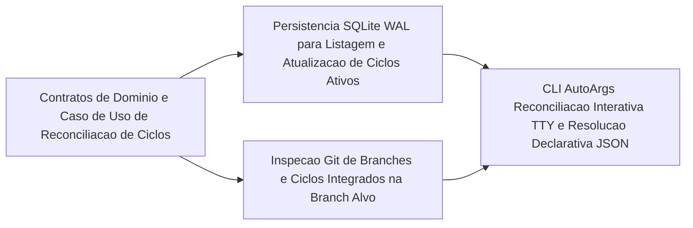

# Especificacao: reconciliacao-de-ciclos-ativos-concorrentes-e-fechamento-automatico-de-ciclos-mergeados-no-tk-auto

## 1. Product Trio

- **PM**: Operadores humanos e agentes autonomos que utilizam `tk auto --issue <N>` frequentemente encontram falhas prematuras (`EMPTY_TASK_BACKLOG_FAULT`) ou reutilizacao indevida de ciclos ativos anteriores que ja foram mergeados via GitHub PR ou que estao no Gate 0 com backlog de tarefas vazio. Precisamos que o TRustKit liste ciclos concorrentes, permita selecionar ou criar ciclos deterministicamente, feche automaticamente ciclos cujas branches ja foram integradas na branch alvo (`develop`/`main`), descarte orfaos vazios em Gate 0 e forneca orientacao clara via `next_steps` caso a especificacao estruturada ainda nao exista.
- **Tech Lead**: Definir em `trustkit-core` os contratos puros de repositorio (`list_active_cycles`), portas de interacao e o caso de uso de reconciliacao (`ReconcileActiveCyclesRequest`, `ReconcileActiveCyclesOutcome`) com isolamento hexagonal estrito (`std` only). Em `trustkit-db`, implementar no `SqliteWalRepositoryAdapter` a consulta indexada de ciclos com `lifecycle_status = 'ACTIVE'` e a transicao em lote para `MERGED`. Em `trustkit-gh`, implementar em `GitInspector` a verificacao deterministica de ancestralidade de commits/branches integrados via Git (`git merge-base --is-ancestor`). Em `trustkit-cli`, expor as flags `--new`, `--close-merged` e `--reuse-cycle <ID>` no `AutoArgs`, habilitar selecao interativa quando em terminal TTY (`io::stdin().is_terminal()`), preservar saida JSON livre de `null` e aprimorar o disjuntor semantico para orientar formalmente a criacao de `spec.md` no Gate 1.
- **Design / QA**: Garantir conformidade integral com os invariantes constitucionais: proibicao absoluta de emojis, zero trailers de autoria IA, modo TTY estruturado com marcadores alfanumericos e rodape `NEXT STEP:`, modo `--json` deterministico para agentes, e cobertura TDD estrita com fase RED demonstrada antes de GREEN para todas as novas funcoes e comandos.

## 2. Diagrama de Fluxo (Mermaid)

## 3. Criterios de Aceitacao (Gherkin)

### Cenario 1: Contratos puros de dominio e caso de uso de reconciliacao (Atendimento de RF-001)

- **Dado** o ciclo de vida SDD e os contratos de dominio em `trustkit-core`
- **Quando** o caso de uso de reconciliacao avaliar multiplos ciclos ativos existentes no repositorio
- **Entao** classifica com precisao quais ciclos estao orfaos no Gate 0 sem tarefas, quais possuem tarefas ativas e resolve os proximos passos deterministicos via `NextStepResolver`.

### Cenario 2: Listagem e atualizacao em lote de ciclos ativos em SQLite (Atendimento de RF-002)

- **Dado** o banco de dados `.trustkit/state.db` contendo ciclos em status `ACTIVE` e `MERGED`
- **Quando** o adaptador `SqliteWalRepositoryAdapter::list_active_cycles` for invocado
- **Entao** retorna todos os registros com `lifecycle_status = 'ACTIVE'` e permite a atualizacao atomica em lote para `MERGED` sem corromper a integridade WAL.

### Cenario 3: Verificacao Git de integracao de branch na branch alvo (Atendimento de RF-003)

- **Dado** um repositorio Git com historico de branches e commits de ciclos anteriores
- **Quando** o `GitInspector::is_branch_merged_into` testar se a branch ou commit base de um ciclo ja e ancestral da branch alvo
- **Entao** retorna verdadeiro se o commit ja estiver integrado no historico alvo e falso caso a branch ainda possua alteracoes exclusivas pendentes.

### Cenario 4: Subcomando CLI auto com flags declarativas e modo interativo TTY (Atendimento de RF-004)

- **Dado** a invocacao de `tk auto --issue <N>` ou `trustkit auto`
- **Quando** existirem ciclos ativos concorrentes em modo TTY interativo ou com as flags `--new`, `--close-merged` e `--reuse-cycle <ID>` em modo `--json`
- **Entao** o CLI reconcilia os ciclos sem travar a entrada padrao em modo autonomo, fecha ciclos mergeados quando solicitado e emite orientacao de Gate 1 no `next_steps` se a especificacao ainda nao estiver materializada.

## 4. Matriz de Rastreabilidade

| Regra Negocio | Requisito Funcional | Tarefa | No Mermaid | Teste Unitario / Integracao | Evidencia / Verificacao |
| :--- | :--- | :--- | :--- | :--- | :--- |
| RN-001 | RF-001 | TASK-001 | Node1 | crates/trustkit-core/tests/cycle_reconciliation_domain_tests.rs | EV-001-cycle-reconciliation-domain.json |
| RN-002 | RF-002 | TASK-002 | Node2 | crates/trustkit-db/tests/sqlite_active_cycles_tests.rs | EV-002-sqlite-active-cycles.json |
| RN-003 | RF-003 | TASK-003 | Node3 | crates/trustkit-gh/tests/git_branch_integration_tests.rs | EV-003-git-branch-integration.json |
| RN-004 | RF-004 | TASK-004 | Node4 | crates/trustkit-cli/tests/cli_auto_reconciliation_tests.rs | EV-004-cli-auto-reconciliation.json |
