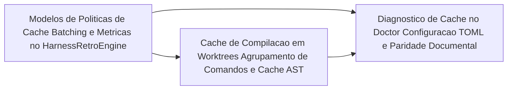

# Especificacao: cache-local-e-agrupamento-de-chamadas-batching-na-execucao-de-ferramentas-do-harness

## 1. Product Trio

- **PM**: Durante a execucao autonoma de ciclos do SDD, a retrospectiva gerada pelo Gauntlet no Gate 6 diagnosticou a oportunidade de otimizacao de Economia de Ferramentas. Atualmente, o orquestrador e os despachantes executam comandos de terminal, verificacoes e testes de forma isolada e repetitiva para cada tarefa atomica em cada worktree. Precisamos implementar cache local de compilacao (`sccache` ou `target-dir` compartilhado), agrupamento inteligente (batching) de chamadas compativeis por onda ou crate, cache de analises AST e acoplamento estrutural para arquivos inalterados, diagnostico no `trustkit doctor` e quantificacao da economia na retrospectiva do Gate 6.
- **Tech Lead**: Definir em `trustkit-core` os modelos de politicas de cache e lote (`ToolCachingPolicy`, `BatchExecutionConfig`, `CompilationCacheBackend`, `BatchGroupingMode`, `HarnessExecutionPolicyConfig`, `ToolEconomyMetrics`) com parser puro em `std` para `trustkit.toml` e atualizar `HarnessRetroEngine` para quantificar a taxa de reaproveitamento de cache e o tempo medio de ciclo. Em `trustkit-orch`, integrar cache de compilacao (`RUSTC_WRAPPER=sccache` e `target-dir` compartilhado seguro) em `WorktreeIsolationProvider`, otimizar `BuilderAgentDispatcher` e `AsyncExecutionSupervisor` para agrupar chamadas compativeis preservando rastreabilidade por tarefa com fallback granular em caso de falha, e implementar `AstWaveAnalysisCache` indexado por digest BLAKE3 para evitar reanalise AST e de acoplamento estrutural de arquivos nao modificados entre ondas. Em `trustkit-cli`, atualizar `doctor_cmd.rs` para detectar e reportar o status do `sccache` e orientar instalacao se ausente, suportar `[harness.execution]` em `trustkit.toml` e sincronizar toda a documentacao.
- **Design / QA**: Garantir conformidade integral com os invariantes constitucionais: proibicao absoluta de emojis, zero trailers de autoria IA, isolamento hexagonal estrito (`std` only em `trustkit-core`), contratos JSON deterministicos livres de `null`, cobertura TDD estrita com fase RED demonstrada antes de GREEN para cada tarefa atomica e paridade documental completa nos READMEs e manuais em Markdown e HTML.

## 2. Diagrama de Fluxo (Mermaid)

## 3. Criterios de Aceitacao (Gherkin)

### Cenario 1: Modelos de politicas de cache e batching e quantificacao no HarnessRetroEngine (Atendimento de RF-001)

- **Dado** os contratos puros de dominio em `trustkit-core` e um conjunto de evidencias de execucao do ciclo SDD
- **Quando** `ToolCachingPolicy`, `BatchExecutionConfig` e `HarnessRetroEngine::analyze_events` processarem configuracoes de `trustkit.toml` e eventos de execucao com cache ou batching ativos
- **Entao** valida os parametros de politica, quantifica deterministicamente a taxa de reaproveitamento de cache e o tempo medio de ciclo em `ToolEconomyMetrics`, e reflete a economia de ferramentas na retrospectiva do Gate 6.

### Cenario 2: Cache de compilacao em worktrees, batching de chamadas e cache local AST entre ondas (Atendimento de RF-002)

- **Dado** multiplas tarefas atomicas executadas em worktrees isolados e ondas consecutivas em `trustkit-orch`
- **Quando** `WorktreeIsolationProvider`, `BuilderAgentDispatcher`, `AsyncExecutionSupervisor` e `AstWaveAnalysisCache` forem acionados com politicas de cache e agrupamento habilitadas
- **Entao** propaga `RUSTC_WRAPPER=sccache` ou `target-dir` compartilhado seguro entre worktrees, agrupa verificacoes e testes compativeis por crate ou onda preservando a rastreabilidade por tarefa e reutiliza analises AST e de acoplamento estrutural para arquivos cujo digest BLAKE3 nao mudou.

### Cenario 3: Diagnostico de cache local no trustkit doctor, configuracao trustkit.toml e paridade documental (Atendimento de RF-003)

- **Dado** um projeto governado pelo TRustKit com `trustkit.toml` configurado e um ciclo SDD ativo
- **Quando** o operador ou agente executar `trustkit doctor --json` ou inicializar o projeto com `trustkit init`
- **Entao** o CLI carrega as politicas de `[harness.execution]` do `trustkit.toml`, detecta a presenca do `sccache` no ambiente, reporta o status do cache local orientando a instalacao caso ausente e mantem paridade documental completa.

## 4. Matriz de Rastreabilidade

| Regra Negocio | Requisito Funcional | Tarefa | No Mermaid | Teste Unitario / Integracao | Evidencia / Verificacao |
| :--- | :--- | :--- | :--- | :--- | :--- |
| RN-001 | RF-001 | TASK-001 | Node1 | crates/trustkit-core/tests/tool_caching_policy_tests.rs | EV-001-tool-caching-policy-core.json |
| RN-002 | RF-002 | TASK-002 | Node2 | crates/trustkit-orch/tests/tool_cache_batch_executor_tests.rs | EV-002-tool-cache-batch-orch.json |
| RN-003 | RF-003 | TASK-003 | Node3 | crates/trustkit-cli/tests/cli_doctor_cache_and_config_tests.rs | EV-003-doctor-cache-cli.json |
