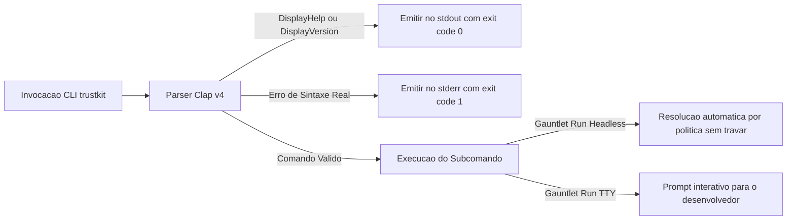

# Especificacao: fix-cli-help-exit-code-and-gauntlet-headless

## 1. Product Trio

- **PM**: Garantir que operadores humanos e agentes autonomos possam inspecionar a documentacao de ajuda (`--help`, `-h`) e versao (`--version`, `-V`) de qualquer comando do trustkit sem falsos positivos de erro (retornando exit code 0 e escrevendo no stdout). Garantir que comandos criticos como `trustkit gauntlet run` e `trustkit auto` nao travem em prompts interativos quando executados em ambientes headless ou sob subprocessos de agentes sem TTY.
- **Tech Lead**: Refatorar o tratamento de erro em `crates/trustkit-cli/src/main.rs` para respeitar `clap_err.exit_code()` e direcionar mensagens informativas para stdout quando `clap_err.use_stderr()` for falso. Ajustar o carregamento da politica de seguranca em `gauntlet_run_cmd.rs` para inspecionar a raiz do repositorio de trabalho. Garantir compatibilidade com entrada posicional amigavel no comando `trustkit auto` e manutencao dos principios constitucionais de zero panic e zero emojis.
- **Design / QA**: Implementar testes de integracao verificando que `trustkit --help`, `trustkit gauntlet --help`, `trustkit gauntlet run --help` e subcomandos associados encerram com status 0 no stdout, enquanto argumentos invalidos encerram com status 1 ou 2 no stderr. Testar execucao headless sem TTY para gauntlet run e execucao do motor auto.

## 2. Diagrama de Fluxo (Mermaid)

## 3. Criterios de Aceitacao (Gherkin)

### Cenario 1: Inspecao de ajuda com retorno de sucesso (Atendimento de RF-001 e RF-002)

- **Dado** o binario do trustkit compilado no workspace
- **Quando** o desenvolvedor ou agente executar `trustkit gauntlet run --help`
- **Entao** o comando deve emitir a mensagem de ajuda no stdout e encerrar com exit code 0.

### Cenario 2: Tratamento de erro real de argumentos invalidos (Atendimento de RF-003)

- **Dado** o binario do trustkit compilado no workspace
- **Quando** o desenvolvedor ou agente executar `trustkit comando-inexistente`
- **Entao** o comando deve emitir o diagnostico de erro no stderr e encerrar com exit code diferente de zero.

### Cenario 3: Execucao headless nao-interativa do gauntlet run (Atendimento de RF-004)

- **Dado** um ciclo SDD ativo no Gate 4 ou 5 sem terminal interativo TTY
- **Quando** o comando `trustkit gauntlet run` for disparado sem flags de seguranca
- **Entao** o motor deve resolver a decisao por politica padrao sem bloquear aguardando stdin.

### Cenario 4: Invocacao flexivel do comando trustkit auto com argumento posicional (Atendimento de RF-005)

- **Dado** uma solicitacao de execucao autonoma com link ou identificador de issue
- **Quando** o desenvolvedor executar `trustkit auto https://github.com/mymakecoins/TRustKit/issues/7`
- **Entao** o comando deve aceitar o identificador posicionalmente e disparar o ciclo autono correspondente.

## 4. Matriz de Rastreabilidade

| Regra Negocio | Requisito Funcional | Tarefa | No Mermaid | Teste Unitario / Integracao | Evidencia / Verificacao |
| :--- | :--- | :--- | :--- | :--- | :--- |
| RN-001 | RF-001 | TASK-001 | StdoutHelp | crates/trustkit-cli/tests/cli_help_exit_code_tests.rs | EV-001-help-stdout.json |
| RN-002 | RF-002 | TASK-001 | StdoutHelp | crates/trustkit-cli/tests/cli_help_exit_code_tests.rs | EV-002-version-stdout.json |
| RN-003 | RF-003 | TASK-002 | StderrError | crates/trustkit-cli/tests/cli_help_exit_code_tests.rs | EV-003-invalid-args-stderr.json |
| RN-004 | RF-004 | TASK-003 | NonInteractive | crates/trustkit-cli/tests/cli_gauntlet_headless_tests.rs | EV-004-gauntlet-headless.json |
| RN-005 | RF-005 | TASK-004 | Dispatcher | crates/trustkit-cli/tests/cli_auto_args_tests.rs | EV-005-auto-positional.json |
