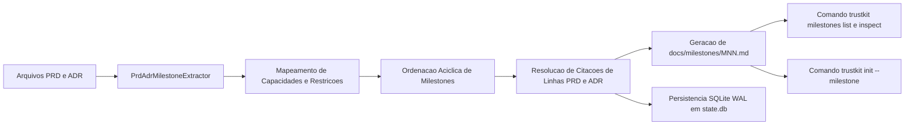

# Especificacao: milestone-planning-from-prd-and-adr

## 1. Product Trio

- **PM**: Operadores humanos e agentes enfrentam sobrecarga cognitiva e perda de foco ao rodar o comando `trustkit init` diretamente contra um PRD monolitico de um sistema completo. O TRustKit deve fornecer uma etapa previa de planejamento de marcos (`trustkit milestones plan`), capaz de estudar em conjunto o PRD e o ADR, identificar capacidades de negocio e restricoes tecnicas, agrupar essas capacidades em milestones ordenados e verificaveis, gerar arquivos dedicados em `docs/milestones/` com citacao exata de intervalos de linhas dos documentos de origem, e habilitar o comando `trustkit init --milestone <CAMINHO>` para inicializar ciclos SDD focados no marco selecionado.
- **Tech Lead**: Implementar a funcionalidade seguindo a arquitetura hexagonal estrita do TRustKit. No `trustkit-core`, definir as entidades de dominio `Milestone`, `MilestonePlan`, `MilestoneCapability`, `SourceCitation` e os ports abstratos com zero dependencias externas. No `trustkit-ast`, desenvolver o analisador estatico de PRD e ADR para extracao de secoes, mapeamento de restricoes tecnicas e resolucao precisa de numeros de linha. No `trustkit-db`, estender o schema SQLite WAL com a tabela transacional `milestones` e migracao idempotente. No `trustkit-cli`, introduzir o subcomando `trustkit milestones` (com `plan`, `list` e `inspect`) e adicionar o parametro `--milestone` ao `trustkit init`. Garantir tempo de execucao inferior a 150ms, saida JSON deterministicamente sem null, ausencia absoluta de panics e conformidade constitucional com zero emojis e zero trailers de IA.
- **Design / QA**: Formular suite de testes automatizados unitarios e de integracao cobrindo analise de PRD/ADR, deteccao e citacao de linhas, validacao de ciclos aciclicos (DAG) entre milestones, persistencia SQLite, comandos CLI com modos texto e `--json`, geracao de artefatos Markdown em `docs/milestones/`, validacao de contratos de erro quando arquivos nao existirem e sincronizacao da documentacao (manuais Markdown e HTML, README e atualizacao de grafos Archify).

## 2. Diagrama de Fluxo (Mermaid)

## 3. Criterios de Aceitacao (Gherkin)

### Cenario 1: Planejamento nominal de milestones a partir de PRD e ADR (Atendimento de RF-001 e RF-002)

- **Dado** a presenca de um arquivo PRD valido e um arquivo ADR valido no repositorio
- **Quando** o desenvolvedor ou agente executar `trustkit milestones plan --prd docs/PRD_TRustKit.md --adr docs/ADR_001_TRustKit_Architecture.md`
- **Entao** o comando deve analisar o conteudo, derivar uma lista ordenada de milestones aciclicos, gerar os arquivos em `docs/milestones/` e retornar status de sucesso com exit code 0.

### Cenario 2: Rastreabilidade com citacao precisa de intervalos de linhas (Atendimento de RF-003)

- **Dado** a geracao dos arquivos de milestone na pasta `docs/milestones/`
- **Quando** o conteudo de qualquer arquivo de marco individual `docs/milestones/M*.md` for inspecionado
- **Entao** cada capacidade e restricao tecnica deve referenciar diretamente o arquivo de origem com a indicacao exata das linhas inicial e final (exemplo: `docs/PRD_TRustKit.md#L45-L68`).

### Cenario 3: Persistencia e consulta de milestones via CLI e JSON (Atendimento de RF-004)

- **Dado** que os milestones foram planejados e persistidos no banco transacional SQLite WAL
- **Quando** o operador executar `trustkit milestones list --json` ou `trustkit milestones inspect M01 --json`
- **Entao** o CLI deve retornar a colecao completa de marcos cadastrados com seus metadados, dependencias, status e sem campos nulos.

### Cenario 4: Inicializacao de ciclo SDD direcionada por marco (Atendimento de RF-005)

- **Dado** a existencia do arquivo de marco `docs/milestones/M01-fundacao.md`
- **Quando** o operador executar `trustkit init --milestone docs/milestones/M01-fundacao.md`
- **Entao** o ciclo SDD no Gate 0 deve ser inicializado tendo o escopo e os criterios do marco selecionado como baseline de especificacao.

### Cenario 5: Atualizacao documental e manuais tecnicos (Atendimento de RF-006)

- **Dado** a conclusao da implementacao da funcionalidade de milestones
- **Quando** a suite documental for homologada
- **Entao** os manuais do usuario em Markdown e HTML autonomo, o README principal e os diagramas de arquitetura Archify devem refletir os novos fluxos de trabalho e subcomandos.

## 4. Matriz de Rastreabilidade

| Regra Negocio | Requisito Funcional | Tarefa | No Mermaid | Teste Unitario / Integracao | Evidencia / Verificacao |
| :--- | :--- | :--- | :--- | :--- | :--- |
| RN-001 | RF-001 | TASK-001 | AstParser | crates/trustkit-ast/tests/milestone_extractor_tests.rs | EV-001-milestone-ast-extraction.json |
| RN-002 | RF-002 | TASK-002 | DiskArtifacts | crates/trustkit-core/tests/milestone_plan_tests.rs | EV-002-milestones-disk-artifacts.json |
| RN-003 | RF-003 | TASK-003 | LineCiter | crates/trustkit-ast/tests/milestone_citation_tests.rs | EV-003-line-citation-accuracy.json |
| RN-004 | RF-004 | TASK-004 | DbStorage | crates/trustkit-db/tests/sqlite_milestone_repository_tests.rs | EV-004-sqlite-milestone-persistence.json |
| RN-005 | RF-005 | TASK-005 | CliInit | crates/trustkit-cli/tests/cli_milestone_and_init_tests.rs | EV-005-cli-milestone-and-init.json |
| RN-006 | RF-006 | TASK-006 | CliMilestones | crates/trustkit-cli/tests/doc_and_manual_sync_tests.rs | EV-006-docs-and-manuals-sync.json |
