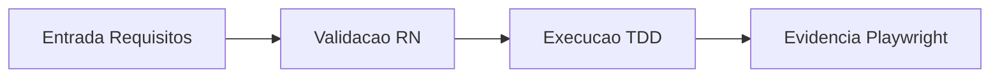

# Especificacao: 003-ast-layer0-context-slicer

## 1. Product Trio

- **PM**: Definicao de valor de negocio e regras.
- **Tech Lead**: Arquitetura, viabilidade e seguranca.
- **Design / QA**: Criterios de aceitacao e cenarios E2E.

## 2. Diagrama de Fluxo (Mermaid)

## 3. Criterios de Aceitacao (Gherkin)

### Cenario 1: Atendimento de RF-001

- **Dado** requisito RF-001 habilitado no sistema
- **Quando** Inicialização Concorrente e Sincronização de Board (`Gate 0`): Cenário 1.1 (Com Issue Vinculada):** **Dado** que o repositório possui árvore Git acessível e o desenvolvedor executa `trustkit init --issue 45`, **quando** o comando inicia, **então** o binário valida a conta GitHub ativa, preserva arquivos sujos pré-existentes na lista `PreExistingDirtyFiles` (sem executar `git stash`), move o card `#45` para `In progress`, cria `docs/specs/issue-45-AAAAMMDDHHMM/` e registra o ciclo `SddCycle` no SQLite com `Exit Code: 0` em `< 250ms`. **Cenário 1.2 (Caso Especial Sem Issue):** **Dado** que `trustkit init` é invocado sem argumento `--issue` e fora de uma branch de feature (`feat/<id>-...`), **quando** o comando inicia, **então** o binário instancia o Caso Especial `IssueTarget::UnlinkedCycle`, cria o diretório `docs/specs/no-issue-AAAAMMDDHHMM/`, não move nenhum card no GitHub Projects e solicita confirmação explícita ao usuário.
- **Entao** a operacao deve ser validada e persistida

### Cenario 2: Atendimento de RF-002

- **Dado** requisito RF-002 habilitado no sistema
- **Quando** Ingestão Upstream de PRD/ADR (`Gate 0a`): Cenário 2.1 (PRD Válido):** **Dado** um arquivo PRD/ADR contendo tabelas de `RN` e `RF`, **quando** `trustkit spec init --from-prd docs/PRD.md` é executado, **então** o ingestor gera `<topico>-spec.md` com as seções do Product Trio, Gherkin e Matriz de Rastreabilidade pré-populadas. **Cenário 2.2 (Arquivo PRD Ausente ou Malformado):** **Dado** que o caminho informado em `--from-prd` não existe ou não contém tabelas `RN`/`RF`, **quando** o comando é executado, **então** o binário aborta com `Exit Code: 2` (`SpecIngestionError::MissingBusinessRules`), sem criar arquivo parcial em disco.
- **Entao** a operacao deve ser validada e persistida

### Cenario 3: Atendimento de RF-003

- **Dado** requisito RF-003 habilitado no sistema
- **Quando** Validação e Congelamento Criptográfico da Spec V2 (`Gate 1 & Gate 2`): Cenário 3.1 (Spec Completa):** **Dado** um arquivo `<topico>-spec.md` contendo diagrama Mermaid `flowchart LR`, critérios em Gherkin e Matriz $\text{RN} \rightarrow \text{RF} \rightarrow \text{TASK} \rightarrow \text{E2E} \rightarrow \text{Screenshot}$ 100% fechada, **quando** `trustkit spec lock` é executado, **então** o binário grava o estado `SpecLockState::Frozen { blake3_digest }` no SQLite em `< 5ms` e avança para `GATE_2_LOCKED`. **Cenário 3.2 (Regra de Negócio Órfã na Matriz):** **Dado** uma Spec onde a `RN-002` não possui `TASK` ou `Screenshot` correspondente na Matriz de Rastreabilidade, **quando** `trustkit spec lock` é executado, **então** o binário rejeita o congelamento (`Exit Code: 3`) e retorna o objeto `TraceabilityGap { orphan_rule: "RN-002" }`.
- **Entao** a operacao deve ser validada e persistida

### Cenario 4: Atendimento de RF-004

- **Dado** requisito RF-004 habilitado no sistema
- **Quando** Planejamento de Ondas via DAG (`Gate 3`): Cenário 4.1 (Grafo Acíclico Válido):** **Dado** um conjunto de arquivos `TASK-NNN.md` sem dependências circulares, **quando** `trustkit wave plan` é executado, **então** o planejador retorna a estrutura `WaveSchedule` dividida em ondas topológicas e separa automaticamente em ondas distintas quaisquer tarefas que declarem tocar o mesmo arquivo. **Cenário 4.2 (Dependência Circular Detectada):** **Dado** que `TASK-001` depende de `TASK-002` e `TASK-002` depende de `TASK-001`, **quando** `trustkit wave plan` é executado, **então** o planejador aborta em `< 2ms` com `DagValidationError::CycleDetected { cycle_path: ["TASK-001", "TASK-002"] }`.
- **Entao** a operacao deve ser validada e persistida

### Cenario 5: Atendimento de RF-005

- **Dado** requisito RF-005 habilitado no sistema
- **Quando** Fiscalização Determinística do Ciclo TDD (`Gate 4`): Cenário 5.1 (Ciclo RED -> GREEN Válido):** **Dado** que o Builder registrou uma execução `trustkit task test TASK-001 --phase red` com falha comprovada (`Exit Code != 0`) e posteriormente uma execução `--phase green` passando (`Exit Code == 0`), **quando** `trustkit task complete TASK-001` é invocado, **então** a tarefa transiciona para `TddLifecycleState::GreenVerified`. **Cenário 5.2 (Violação de Ordem TDD — Sem Fase RED):** **Dado** que o Builder tenta executar `--phase green` ou `task complete` sem registro prévio de `TddLifecycleState::RedVerified` no SQLite, **quando** o comando é chamado, **então** o binário bloqueia a transição com `TddViolationError::MissingRedPhaseProof`.
- **Entao** a operacao deve ser validada e persistida

### Cenario 6: Atendimento de RF-006

- **Dado** requisito RF-006 habilitado no sistema
- **Quando** Isolamento e Merge de Worktrees por Onda (`Gate 4`): Dado** uma onda contendo $N$ tarefas independentes, **quando** `trustkit wave run --wave <W>` é disparado, **então** o `WorktreeIsolationProvider` instancia $N$ worktrees efêmeras em `.trustkit/worktrees/`, executa os Builders em paralelo via `tokio`, valida os commits no padrão `<type>: #<id> <descricao em pt-BR>` e realiza o merge determinístico na branch de trabalho (`feat/<id>-<slug>`).
- **Entao** a operacao deve ser validada e persistida

### Cenario 7: Atendimento de RF-007

- **Dado** requisito RF-007 habilitado no sistema
- **Quando** Auditoria AST Anti-Cheat e Invariantes — Camada 0 (`Gate 5`): Cenário 7.1 (Código Limpo e Íntegro):** **Dado** que o diff da branch não alterou a Spec congelada, manteve todas as asserções pré-existentes intactas e não introduziu emojis, `any` ou trailers de IA, **quando** `trustkit gauntlet ast-audit` é executado, **então** retorna o Caso Especial `AstAuditVerdict::CleanPass { violations: [] }` em `< 5ms`. **Cenário 7.2 (Detecção de Test Dilution / Anti-Cheat):** **Dado** que um Builder comentou um `expect()` ou adicionou `.skip` em um teste listado em `artifact_locks`, **quando** `trustkit gauntlet ast-audit` é executado, **então** retorna `AstAuditVerdict::Rejected` com `TestIntegrityViolation { file, line, removed_assertions }` e `Exit Code: 4`, impedindo o disparo dos Críticos LLM.
- **Entao** a operacao deve ser validada e persistida

### Cenario 8: Atendimento de RF-008

- **Dado** requisito RF-008 habilitado no sistema
- **Quando** Orquestração do Swarm de Críticos e Playwright E2E — Camada 1 (`Gate 5`): Dado** que a Camada 0 retornou `CleanPass`, **quando** `trustkit gauntlet run` inicia a Camada 1, **então** o motor dispara concorrentemente os 4 Críticos (Adversarial de Domínio/Técnico, Contrato, Estático/Build e E2E Playwright), confirma a gravação das screenshots da Jornada Mermaid em `docs/specs/<issue-id>-AAAAMMDDHHMM/tests/evidence/` e executa `git checkout --` em qualquer screenshot de outra issue tocada durante a bateria.
- **Entao** a operacao deve ser validada e persistida

### Cenario 9: Atendimento de RF-009

- **Dado** requisito RF-009 habilitado no sistema
- **Quando** Disjuntor de Segurança / Circuit Breaker (`Gate 5`): Dado** que o ciclo acumulou 4 reprovações no Gauntlet, **quando** a 5ª iteração consecutiva resulta em `FAIL`, **então** o motor transiciona o ciclo para `CycleStatus::CircuitBreakerTripped`, bloqueia novas execuções de `wave run` ou `gauntlet run` e gera automaticamente o relatório de diagnóstico (`trustkit doctor`).
- **Entao** a operacao deve ser validada e persistida

### Cenario 10: Atendimento de RF-010

- **Dado** requisito RF-010 habilitado no sistema
- **Quando** Certificação Imutável e Comentário na Issue (`Gate 6`): Dado** que a Camada 0, os 4 Críticos, o lint/build e o Playwright E2E possuem eventos `PASS` (`Exit Code: 0`) no SQLite, **quando** `trustkit done` é executado, **então** o binário renderiza `gauntlet-report.md` a partir dos registros do banco, commita as evidências na branch, publica o comentário na issue com a Matriz de Rastreabilidade e tags ``, e aguarda a decisão de destino de merge do usuário.
- **Entao** a operacao deve ser validada e persistida

### Cenario 11: Atendimento de RF-011

- **Dado** requisito RF-011 habilitado no sistema
- **Quando** Gate de Merge e Transição para `Await Staging: Dado** um ciclo em estado `CycleStatus::Certified` e confirmação do usuário para mergear em `develop`, **quando** `trustkit merge --target develop` é executado, **então** o binário realiza o merge e move o card no GitHub Projects para `Await Staging` mantendo a issue aberta.
- **Entao** a operacao deve ser validada e persistida

### Cenario 12: Atendimento de RF-012

- **Dado** requisito RF-012 habilitado no sistema
- **Quando** Abertura de Pull Request Exclusivamente Sob Demanda: Dado** que o usuário invocou explicitamente `trustkit pr`, **quando** o comando executa, **então** o binário abre o PR para `develop` com revisores e assignees configurados, referência `Ref #<id>` (rejeitando `Closes`/`Fixes`/`Resolves`), Matriz de Rastreabilidade e imagens HTML, movendo o card para `In review`.
- **Entao** a operacao deve ser validada e persistida

### Cenario 13: Atendimento de RF-013

- **Dado** requisito RF-013 habilitado no sistema
- **Quando** Interceptação Preventiva via Hooks (`PreToolUse`): Dado** que o agente hospedeiro tenta invocar uma ferramenta shell contendo `git stash`, `git add .`, `git add -A`, commit direto em branch protegida ou `gh pr create` fora do fluxo, **quando** `trustkit hook pre-tool` inspeciona o comando, **então** o binário nega a execução em `< 3ms` retornando a invariante violada.
- **Entao** a operacao deve ser validada e persistida

## 4. Matriz de Rastreabilidade

| Regra Negocio | Requisito Funcional | Tarefa | No Mermaid | Teste Playwright | Screenshot |
| :--- | :--- | :--- | :--- | :--- | :--- |
| RN-001 | RF-001 | TASK-001 | Node1 | tests/e2e/003-ast-layer0-context-slicer.spec.ts | SC-001.png |
| RN-002 | RF-002 | TASK-002 | Node2 | tests/e2e/003-ast-layer0-context-slicer.spec.ts | SC-002.png |
| RN-003 | RF-003 | TASK-003 | Node3 | tests/e2e/003-ast-layer0-context-slicer.spec.ts | SC-003.png |
| RN-004 | RF-004 | TASK-004 | Node4 | tests/e2e/003-ast-layer0-context-slicer.spec.ts | SC-004.png |
| RN-005 | RF-005 | TASK-005 | Node5 | tests/e2e/003-ast-layer0-context-slicer.spec.ts | SC-005.png |
| RN-006 | RF-006 | TASK-006 | Node6 | tests/e2e/003-ast-layer0-context-slicer.spec.ts | SC-006.png |
| RN-007 | RF-007 | TASK-007 | Node7 | tests/e2e/003-ast-layer0-context-slicer.spec.ts | SC-007.png |
| RN-008 | RF-008 | TASK-008 | Node8 | tests/e2e/003-ast-layer0-context-slicer.spec.ts | SC-008.png |
| RN-009 | RF-009 | TASK-009 | Node9 | tests/e2e/003-ast-layer0-context-slicer.spec.ts | SC-009.png |
| RN-010 | RF-010 | TASK-010 | Node10 | tests/e2e/003-ast-layer0-context-slicer.spec.ts | SC-010.png |
| RN-011 | RF-011 | TASK-011 | Node11 | tests/e2e/003-ast-layer0-context-slicer.spec.ts | SC-011.png |
| RN-012 | RF-012 | TASK-012 | Node12 | tests/e2e/003-ast-layer0-context-slicer.spec.ts | SC-012.png |
| RN-013 | RF-013 | TASK-013 | Node13 | tests/e2e/003-ast-layer0-context-slicer.spec.ts | SC-013.png |
| RN-014 | RF-001 | TASK-014 | Node14 | tests/e2e/003-ast-layer0-context-slicer.spec.ts | SC-014.png |
| RN-015 | RF-001 | TASK-015 | Node15 | tests/e2e/003-ast-layer0-context-slicer.spec.ts | SC-015.png |
| RN-016 | RF-001 | TASK-016 | Node16 | tests/e2e/003-ast-layer0-context-slicer.spec.ts | SC-016.png |
