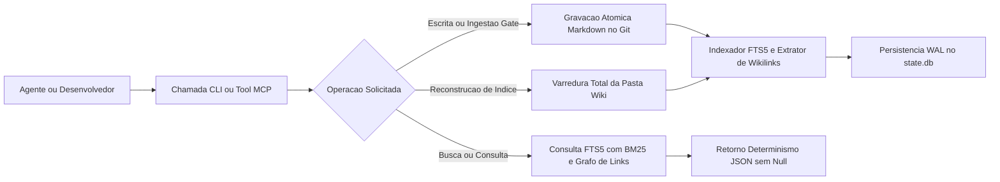

# Especificacao: 005-project-knowledge-memory

## 1. Product Trio

- **PM**: Memoria perene, autocontida e de longo prazo no repositorio local, permitindo que agentes de desenvolvimento e desenvolvedores humanos preservem contexto, convencoes arquiteturais e historico de decisoes entre ciclos SDD e entre diferentes sessoes de trabalho, sem dependencia de servicos ou daemons externos.
- **Tech Lead**: Integracao nativa no binario Rust (`trustkit-core`, `trustkit-db`, `trustkit-orch` e `trustkit-cli`), adotando a Wiki Markdown no Git como Fonte Unica da Verdade (Source of Truth) e uma tabela virtual SQLite FTS5 no `.trustkit/state.db` como indice derivado 100% reconstruivel; exposicao de ferramentas no servidor MCP nativo e gatilhos automaticos nos Gates 2, 4, 5 e 6 do SDD.
- **Design / QA**: Criterios de aceitacao BDD/Gherkin abrangendo escrita de notas com frontmatter, resolucao deterministica de wikilinks (`[[documento]]`), busca lexical ranqueada via BM25, integracao transparente nos Gates de governanca e validacao E2E/Playwright e testes unitarios em Rust sem ocorrencia de valores nulos.

## 2. Diagrama de Fluxo (Mermaid)

## 3. Criterios de Aceitacao (Gherkin)

### Cenario 1: Gravacao Atomica de Documento de Conhecimento (Atendimento de RF-017)

- **Dado** que o desenvolvedor ou agente solicita a criacao ou atualizacao de uma nota conceitual com slug `adrs/adr-002-storage-strategy`
- **Quando** o comando `trustkit memory write adrs/adr-002-storage-strategy --title "Estrategia de Armazenamento" --tags "adr,storage,sqlite" --content "Decisao de persistencia..."` e executado
- **Entao** o binario grava o arquivo `.trustkit/wiki/adrs/adr-002-storage-strategy.md` com frontmatter YAML normalizado, atualiza a tabela virtual `knowledge_pages_fts` no `.trustkit/state.db` em `< 5ms` e retorna `KnowledgeWriteOutcome::Success` com `Exit Code: 0`.

### Cenario 2: Extracao e Indexacao de Wikilinks entre Notas (Atendimento de RF-018)

- **Dado** um documento Markdown contendo referencias bidirecionais no formato `[[adrs/adr-001-architecture]]` e `[[specs/spec-004]]`
- **Quando** o documento e processado pelo extrator sintatico de links
- **Entao** as arestas direcionadas sao inseridas na tabela `knowledge_wiki_links`, permitindo navegacao por grafo de adjacencias entre conceitos do repositorio.

### Cenario 3: Busca Lexical FTS5 com Ranqueamento BM25 (Atendimento de RF-019)

- **Dado** um repositorio contendo multiplas notas tecnicas indexadas na pasta `.trustkit/wiki/`
- **Quando** o usuario ou agente executa `trustkit memory search "sqlite wal concorrência" --limit 5 --json`
- **Entao** o binario executa consulta ranqueada por BM25 sobre o indice FTS5 em `< 3ms`, retornando os 5 melhores resultados com slugs, titulos, trechos contextuais destacados e lista de documentos vinculados, sem campos nulos (`SpecialCase::EmptyKnowledgeList` caso nao haja correspondencias).

### Cenario 4: Reconstrucao Deterministica do Indice Derivado (Atendimento de RF-020)

- **Dado** que o arquivo de banco `.trustkit/state.db` foi removido ou corrompido, mas o diretorio `.trustkit/wiki/` permanece integro no Git
- **Quando** o comando `trustkit memory rebuild --json` e disparado
- **Entao** o motor varre recursivamente todos os arquivos `.md` sob `.trustkit/wiki/`, repopula a tabela `knowledge_pages_fts` e a tabela `knowledge_wiki_links`, emitindo o relatorio `KnowledgeRebuildSummary` com contagem exata de notas e links restaurados.

### Cenario 5: Ingestao Automatica de Especificacao Congelada no Gate 2 (Atendimento de RF-021)

- **Dado** que o ciclo SDD atinge o congelamento formal via `trustkit spec lock`
- **Quando** o selo BLAKE3 e gravado com sucesso no banco de eventos
- **Entao** o orquestrador gera automaticamente uma copia de conhecimento em `.trustkit/wiki/specs/spec-<CYCLE_ID>.md` contendo o resumo dos requisitos, regras de negocio e digest criptografico, indexando-o imediatamente para consultas futuras.

### Cenario 6: Ingestao Automatica de Tarefa Concluida no Gate 4 (Atendimento de RF-022)

- **Dado** que um Builder conclui o ciclo TDD com sucesso e executa `trustkit task complete <TASK_ID>`
- **Quando** o status transiciona para `TddLifecycleState::GreenVerified`
- **Entao** o binario registra um sumario tecnico em `.trustkit/wiki/tasks/<TASK_ID>.md` com arquivos modificados, commit SHA associado e notas de implementacao, preservando o contexto para builders subsequentes.

### Cenario 7: Ingestao Automatica de Diagnostico de Falha no Gate 5 (Atendimento de RF-023)

- **Dado** que o Gauntlet V2 reprova o codigo ou o Circuit Breaker e desarmado apos 5 tentativas consecutivas
- **Quando** o comando `trustkit doctor` ou a transicao de falha ocorre
- **Entao** o motor consolida os erros sanitizados e as falhas de invariantes na nota `.trustkit/wiki/incidents/incident-<CYCLE_ID>-attempt-<N>.md`, tornando o motivo do bloqueio visivel para consultas de recuperacao de contexto.

### Cenario 8: Integracao no Servidor MCP para Consulta em Tempo de Raciocinio (Atendimento de RF-024)

- **Dado** que o agente hospedeiro esta conectado ao servidor MCP nativo do TRustKit (`trustkit mcp`)
- **Quando** o agente invoca a tool `trustkit_knowledge_search` informando a consulta `"regras de validacao de branch"`
- **Entao** o servidor processa a solicitacao sobre o stdio em `< 5ms`, retornando payload JSON estrito com os trechos das regras para consumo direto na janela de contexto do agente.

## 4. Matriz de Rastreabilidade

| Regra Negocio | Requisito Funcional | Tarefa | No Mermaid | Teste Unitario / Integracao | Evidencia / Verificacao |
| :--- | :--- | :--- | :--- | :--- | :--- |
| RN-001 | RF-017 | TASK-001 | Node1 | tests/knowledge_file_repository_tests.rs | EV-001-write-note.json |
| RN-002 | RF-018 | TASK-002 | Node2 | tests/knowledge_link_extractor_tests.rs | EV-002-extract-links.json |
| RN-003 | RF-019 | TASK-003 | Node3 | tests/knowledge_fts5_search_tests.rs | EV-003-search-fts5.json |
| RN-004 | RF-020 | TASK-004 | Node4 | tests/knowledge_rebuild_index_tests.rs | EV-004-rebuild-index.json |
| RN-005 | RF-021 | TASK-005 | Node5 | tests/sdd_gate2_knowledge_hook_tests.rs | EV-005-gate2-ingest.json |
| RN-006 | RF-022 | TASK-006 | Node6 | tests/sdd_gate4_knowledge_hook_tests.rs | EV-006-gate4-ingest.json |
| RN-007 | RF-023 | TASK-007 | Node7 | tests/sdd_gate5_incident_hook_tests.rs | EV-007-gate5-incident.json |
| RN-008 | RF-024 | TASK-008 | Node8 | tests/mcp_knowledge_tools_tests.rs | EV-008-mcp-knowledge.json |
