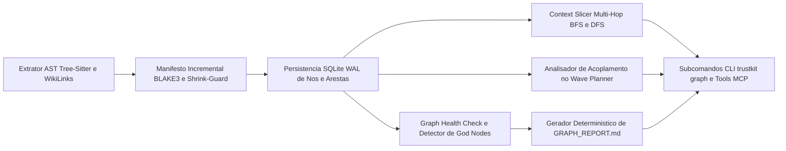

# Especificacao: 006-structural-graph-intelligence

## 1. Product Trio

- **PM**: Inteligencia de grafo estrutural deterministica e persistente para o repositorio local, inspirada nos conceitos de auditoria honesta, deteccao de God Nodes, verificacao de saude de arestas e travessia com orcamento de tokens do Graphify, eliminando conflitos semanticos de merge entre worktrees paralelas e reduzindo drasticamente o consumo de tokens dos agentes construtores sem depender de chamadas LLM no nucleo.
- **Tech Lead**: Expansao nativa nos crates `trustkit-core`, `trustkit-ast`, `trustkit-db`, `trustkit-orch` e `trustkit-cli` combinando extracao sintatica `tree-sitter` com algoritmos de grafo em `petgraph`, manifesto incremental `BLAKE3` com protecao Shrink-Guard no SQLite WAL (`.trustkit/state.db`), fatiamento de contexto multi-hop (BFS/DFS) e exposicao via CLI e servidor MCP stdio em `< 5ms`.
- **Design / QA**: Criterios de aceitacao BDD/Gherkin cobrindo classificacao honesta de arestas (`EXTRACTED`, `INFERRED`, `AMBIGUOUS`), bloqueio de encolhimento acidental do grafo (Shrink-Guard), serializacao automatica de tarefas com acoplamento AST no planejador de ondas, diagnostico de integridade (links orfaos, self-loops e God Nodes) e cobertura integral livre de valores `null`.

## 2. Diagrama de Fluxo (Mermaid)

## 3. Criterios de Aceitacao (Gherkin)

### Cenario 1: Modelagem de Dominio e Classificacao Honesta de Arestas (Atendimento de RF-025)

- **Dado** que o subsistema de grafo estrutural registra relacoes entre arquivos de codigo, simbolos publicos, notas de conhecimento e requisitos de especificacao
- **Quando** uma aresta estrutural e instanciada no dominio `trustkit-core`
- **Entao** ela classifica obrigatoriamente o grau de confianca em `EdgeConfidence::Extracted`, `EdgeConfidence::Inferred` ou `EdgeConfidence::Ambiguous`, sem uso de valores `null` e retornando Casos Especiais tipados (`GraphTraversalOutcome::EmptyGraphSlice` ou `ShortestPathOutcome::NoPathConnected`) quando nao houver resultados.

### Cenario 2: Extracao Sintatica Deterministica de Nos e Arestas de Codigo (Atendimento de RF-026)

- **Dado** um conjunto de arquivos de codigo-fonte em Rust ou TypeScript no repositorio
- **Quando** o extrator `AstGraphExtractor` processa as arvores sintaticas via `tree-sitter` sem acionar modelos de linguagem
- **Entao** o motor identifica todos os simbolos publicos (`struct`, `enum`, `trait`, `fn`, `interface`, `class`) e declaracoes de importacao (`use`, `mod`, `import`), gerando nos e arestas com selo `EdgeConfidence::Extracted` em `< 5ms` por arquivo.

### Cenario 3: Atualizacao Incremental via Manifesto BLAKE3 e Protecao Shrink-Guard (Atendimento de RF-027)

- **Dado** um grafo estrutural previamente persistido no banco `.trustkit/state.db` com manifesto de hashes `BLAKE3` por arquivo
- **Quando** o comando `trustkit graph build --update` e executado apos modificacoes pontuais ou quando uma extracao defeituosa tenta reduzir a quantidade de nos existentes sem a flag `--force`
- **Entao** o repositorio reprocessa exclusivamente os arquivos cujo digest `BLAKE3` divergiu e bloqueia qualquer gravacao que reduza o total de nos acima do limiar de seguranca, retornando `GraphHealthVerdict::ShrinkBlocked`.

### Cenario 4: Context Slicing Multi-Hop em Largura e Profundidade com Orcamento (Atendimento de RF-028)

- **Dado** um agente construtor no Gate 4 que necessita do contexto de `crates/trustkit-core/src/use_cases.rs` e de seus contratos adjacentes
- **Quando** o comando `trustkit context slice --file crates/trustkit-core/src/use_cases.rs --mode bfs --hops 2 --budget 120 --json` e invocado
- **Entao** o fatiador percorre o grafo em largura ate 2 saltos priorizando arestas `Extracted`, coleta as assinaturas publicas dos modulos importados respeitando o limite estrito de 120 linhas e devolve `ContextSliceResult` deterministico.

### Cenario 5: Deteccao de Acoplamento AST e God Nodes no Planejamento de Ondas DAG (Atendimento de RF-029)

- **Dado** duas tarefas atomicas `TASK-001` e `TASK-002` sem `depends_on` explicito e com `expected_files` distintos, mas onde o arquivo de `TASK-002` importa diretamente um simbolo publico modificado por `TASK-001` ou ambos alteram um `GodNode`
- **Quando** o comando `trustkit wave plan --json` calcula a topologia de ondas no Gate 3
- **Entao** o `WaveExecutionPlanner` injeta automaticamente uma aresta de precedencia direcionada no `petgraph`, alocando `TASK-001` e `TASK-002` em ondas sequenciais distintas para impedir quebras semanticas entre Git Worktrees paralelas.

### Cenario 6: Gate de Integridade do Grafo e Auditoria de Fronteiras Arquiteturais (Atendimento de RF-030)

- **Dado** um grafo contendo wikilinks apontando para documentos inexistentes, auto-referencias ou acoplamento proibido entre camadas (como `CORE` importando `CLI`)
- **Quando** o diagnostico `trustkit graph health --json` ou `trustkit gauntlet ast-audit --json` e executado
- **Entao** o auditor contabiliza `dangling_edges`, `self_loop_edges`, `collapsed_edges_count`, lista os `GodNodes` por grau de centralidade e sinaliza conexoes surpreendentes que violem a Arquitetura Hexagonal.

### Cenario 7: Consultas de Menor Caminho, Explicacao de No e Relatorio Auditavel (Atendimento de RF-031)

- **Dado** o grafo estrutural consolidado unindo codigo, especificacoes e notas da pasta `.trustkit/wiki/`
- **Quando** o usuario ou agente executa `trustkit graph path <ORIGEM> <DESTINO>`, `trustkit graph explain <NODE_ID>` ou `trustkit graph build`
- **Entao** o motor resolve o menor caminho via BFS no `petgraph`, detalha as conexoes de entrada/saida do no consultado e gera o relatorio auditavel `.trustkit/wiki/graph/GRAPH_REPORT.md` contendo God Nodes, score de coesao por modulo e trilha de auditoria.

### Cenario 8: Exposicao no CLI e Ferramentas Nativas no Servidor MCP (Atendimento de RF-032)

- **Dado** que um agente autonomo esta conectado ao servidor MCP stdio (`trustkit mcp`) ou operando via CLI em modo `--json`
- **Quando** invoca as tools `trustkit_graph_query`, `trustkit_graph_path`, `trustkit_graph_explain` ou `trustkit_graph_health`
- **Entao** o servidor processa a consulta sobre o grafo em `< 5ms`, respondendo com payload JSON deterministico e 100% livre de valores `null`.

## 4. Matriz de Rastreabilidade

| Regra Negocio | Requisito Funcional | Tarefa | No Mermaid | Teste Unitario / Integracao | Evidencia / Verificacao |
| :--- | :--- | :--- | :--- | :--- | :--- |
| RN-001 | RF-025 | TASK-001 | Node1 | crates/trustkit-core/src/graph_entities_tests.rs | EV-001-graph-entities.json |
| RN-002 | RF-026 | TASK-002 | Node2 | crates/trustkit-ast/tests/ast_graph_extractor_tests.rs | EV-002-ast-extractor.json |
| RN-003 | RF-027 | TASK-003 | Node3 | crates/trustkit-db/tests/graph_sqlite_repository_tests.rs | EV-003-incremental-shrink-guard.json |
| RN-004 | RF-028 | TASK-004 | Node5 | crates/trustkit-ast/tests/graph_context_slicer_tests.rs | EV-004-multihop-slicer.json |
| RN-005 | RF-029 | TASK-005 | Node6 | crates/trustkit-ast/tests/wave_coupling_analyzer_tests.rs | EV-005-wave-coupling.json |
| RN-006 | RF-030 | TASK-006 | Node4 | crates/trustkit-ast/tests/graph_health_auditor_tests.rs | EV-006-graph-health.json |
| RN-007 | RF-031 | TASK-007 | Node7 | crates/trustkit-core/tests/structural_graph_use_cases_tests.rs | EV-007-graph-report-path.json |
| RN-008 | RF-032 | TASK-008 | Node8 | crates/trustkit-cli/tests/mcp_graph_tools_tests.rs | EV-008-cli-mcp-graph.json |
