# Especificacao: 007-semantic-review-and-security-gates

## 1. Product Trio

- **PM**: Integracao nativa e complementar das capacidades de revisao semantica multi-angulo (`code-review`), inspecao opcional de vulnerabilidades AppSec em diffs (`security-review`) e auditoria defensiva pre-release (`security-audit`) ao ciclo de governanca do TRustKit, garantindo qualidade logica, seguranca de aplicacao com alto sinal (confianca >= 8/10), controle explicito do desenvolvedor e documentacao viva atualizada em dois idiomas e nos diagramas interativos Archify.
- **Tech Lead**: Extensao deterministica nos crates `trustkit-core`, `trustkit-db`, `trustkit-orch` e `trustkit-cli` introduzindo entidades de dominio livres de `null` (`SecurityReviewMode`, `SecurityReviewDecision`, `SemanticReviewFinding`, `SecurityReviewVerdict`), flags mutuamente exclusivas `--security-review` e `--skip-security-review` nos comandos `trustkit gauntlet run` e `trustkit done`, prompt interativo em TTY com fallback headless para `--json`, persistencia auditavel no SQLite WAL e sincronizacao de `README.md`, `README.en.md` e `docs/diagrams/*.html`.
- **Design / QA**: Criterios de aceitacao BDD/Gherkin cobrindo revisao semantica no Gate 4 (Refactor TDD), resolucao de precedencia entre flags CLI, configuracao de projeto (`trustkit.toml`) e prompt interativo `[s/N]` nos Gates 5 e 6, corte estrito de falsos positivos (confianca >= 8), rastreabilidade integral no relatorio de certificacao, paridade bilingue de documentacao e validacao estrutural dos diagramas Archify.

## 2. Diagrama de Fluxo (Mermaid)

```mermaid
flowchart LR
    Node1[Entidades de Dominio e Politica de Revisao] --> Node2[Configuracao de Projeto trustkit.toml]
    Node2 --> Node3[Gate 4 Refactor Code Review Multi-Angulo]
    Node3 --> Node4[Removedor de Ambiguidade CLI Flags Gate 5 e 6]
    Node4 --> Node5[Prompt Interativo TTY e Fallback Headless JSON]
    Node5 --> Node6[Executor Security Review e Filtro Confianca 8]
    Node6 --> Node7[Persistencia SQLite WAL e Relatorio Gate 6]
    Node7 --> Node8[Orquestrador Pre-Release Security Audit]
    Node8 --> Node9[Atualizacao Bilingue README.md e README.en.md]
    Node9 --> Node10[Atualizacao dos Diagramas Interativos Archify]
```

## 3. Criterios de Aceitacao (Gherkin)

### Cenario 1: Modelagem de Dominio para Revisao Semantica e Vereditos de Seguranca (Atendimento de RF-033)

- **Dado** que o dominio `trustkit-core` representa os modos de operacao, decisoes de execucao e achados de revisao semantica de codigo e seguranca
- **Quando** uma decisao ou veredito de revisao e instanciado no nucleo
- **Entao** o modelo utiliza exclusivamente tipos algebricos estritos (`SecurityReviewMode::Prompt | Always | Disabled`, `SecurityReviewDecision::Execute | Skip { reason } | PromptUser` e `SecurityReviewVerdict::CleanPass | SkippedByDeveloper | VulnerabilitiesDetected`), 100% livre de valores `null` e sem dependencias externas fora de `std`.

### Cenario 2: Resolucao de Politica Padrao via Configuracao do Projeto (Atendimento de RF-034)

- **Dado** um repositorio contendo a secao `[governance.gauntlet]` configurada com `security_review_mode` (`"prompt"`, `"always"` ou `"disabled"`) e `min_confidence_threshold = 8`
- **Quando** o motor inicializa a avaliacao do Gate 5 ou Gate 6 sem flags explicitas na linha de comando
- **Entao** o carregador resolve deterministicamente a politica configurada (assumindo `SecurityReviewMode::Prompt` e limiar `8` como padrao caso o arquivo nao exista) e rejeita valores de limiar fora do intervalo `8..=10`.

### Cenario 3: Inspecao Semantica de Codigo Multi-Angulo na Fase Refactor do Gate 4 (Atendimento de RF-035)

- **Dado** uma tarefa atomica que ja comprovou as fases `RED` e `GREEN` do ciclo TDD no Gate 4
- **Quando** o desenvolvedor ou agente executa `trustkit task review <TASK_ID> --effort medium` ou `trustkit task complete <TASK_ID> --code-review medium`
- **Entao** o orquestrador analisa o diff da tarefa sob os angulos de corretude logica, comportamento removido, contratos cross-file, reuso, simplificacao, eficiencia, altitude e diretrizes do projeto, registrando a evidencia `EvidenceKind::CodeReview` no SQLite WAL antes de concluir a tarefa.

### Cenario 4: Decisao Antecipada via Parametros CLI em `gauntlet run` e `done` (Atendimento de RF-036)

- **Dado** que as validacoes mecanicas da Camada 0 (AST Audit) e Camada 1 (Critic Swarm) do Gauntlet obtiveram aprovacao unanime
- **Quando** o comando `trustkit gauntlet run` ou `trustkit done` e invocado com `--security-review` ou com `--skip-security-review` (tanto no terminal interativo quanto em modo `--json`)
- **Entao** o motor respeita imediatamente a flag informada sem exibir prompt bloqueante no terminal, executando a inspecao AppSec quando `--security-review` estiver presente ou registrando `SkippedByDeveloper` quando `--skip-security-review` for utilizado.

### Cenario 5: Prompt Interativo no Terminal Humano e Fallback Nao-Bloqueante em Modo Agente (Atendimento de RF-037)

- **Dado** que o Gauntlet mecanico aprovou a entrega, a politica ativa e `SecurityReviewMode::Prompt` e nenhuma das flags `--security-review` ou `--skip-security-review` foi passada na linha de comando
- **Quando** o comando `trustkit gauntlet run` ou `trustkit done` alcanca a etapa de revisao de seguranca
- **Entao** em sessao de terminal interativo (TTY) o CLI exibe o prompt `Deseja executar a revisao de seguranca especializada (security-review) no diff desta entrega antes da certificacao final? [s/N]:` assumindo `Nao` como padrao para `<Enter>`, enquanto em modo `--json` ou sem TTY resolve automaticamente para `Skip` sem bloquear o processo.

### Cenario 6: Execucao da `security-review` com Filtro de Alta Confianca e Tratamento de Alertas (Atendimento de RF-038)

- **Dado** que a execucao da `security-review` foi acionada (via flag `--security-review`, resposta `s` no prompt ou politica `"always"`) sobre o diff contra a branch base
- **Quando** o motor avalia as categorias AppSec (Injecoes, Auth/BOLA, Criptografia/Segredos, RCE/XSS e Exposicao de PII) aplicando o filtro de confianca `>= 8/10`
- **Entao** achados com confianca `< 8` sao descartados silenciosamente; se nenhum achado `>= 8` restar, o veredito e `CleanPass`, mas se houver vulnerabilidade `>= 8`, o CLI exibe o alerta detalhado e pergunta no terminal `Deseja abortar o Gate 6 para correcao imediata? [S/n]:` (ou retorna falha com `Exit Code: 5` no modo `--json`).

### Cenario 7: Rastreabilidade Imutavel no SQLite WAL e no `gauntlet-report.md` (Atendimento de RF-039)

- **Dado** o encerramento da etapa de `security-review` (com resultado `CleanPass`, `SkippedByDeveloper` ou `VulnerabilitiesDetected`) e de `code-review`
- **Quando** o comando `trustkit done` consolida as evidencias do ciclo no Gate 6
- **Entao** o binario grava o registro imutavel em `execution_evidences` no `.trustkit/state.db` com digest `BLAKE3` e renderiza no `gauntlet-report.md` o status explicito (`PASS`, `FAIL` ou `SKIPPED (Opt-out pelo desenvolvedor)`) junto ao resumo de achados.

### Cenario 8: Orquestracao Desacoplada de Auditoria Global Pre-Release (Atendimento de RF-040)

- **Dado** um repositorio pronto para homologacao de marco de versao ou merge em branch estavel (`staging` ou `main`)
- **Quando** o desenvolvedor executa `trustkit audit security --profile standard --json` fora do ciclo atomico de uma tarefa individual
- **Entao** o orquestrador dispara o fluxo estruturado da skill `security-audit` em diretorio de saida isolado, valida o ledger de cobertura e registra o sumario de certificacao pre-release sem interferir no estado das worktrees de tarefas.

### Cenario 9: Atualizacao Bilingue da Documentacao Principal (`README.md` e `README.en.md`) (Atendimento de RF-041)

- **Dado** a introducao dos fluxos de revisao semantica no Gate 4, revisao de seguranca opcional nos Gates 5 e 6 e auditoria global pre-release
- **Quando** a documentacao raiz do repositorio (`README.md` em portugues e `README.en.md` em ingles) e atualizada
- **Entao** ambos os documentos descrevem em paridade os novos comandos (`trustkit task review`, flags `--security-review` / `--skip-security-review`, configuracao `[governance.gauntlet]` e `trustkit audit security`), mantendo zero emojis e zero trailers de IA.

### Cenario 10: Atualizacao dos Diagramas Interativos Archify em `docs/diagrams/` (Atendimento de RF-042)

- **Dado** os diagramas arquiteturais standalone HTML/SVG e especificacoes JSON em `docs/diagrams/` (`01-trustkit-architecture`, `02-trustkit-7gates-workflow`, `03-trustkit-task-tdd-sequence` e `05-trustkit-feature-lifecycle`)
- **Quando** os diagramas sao regenerados e validados com o pipeline Archify
- **Entao** refletem visualmente a etapa `Code Review` na fase Refactor do Gate 4, a decisao opcional `Security Review` na transicao dos Gates 5 e 6 e o portao pre-release `Security Audit`, preservando exportacao SVG/PNG/WebM e zero sobreposicao de nos ou labels.

## 4. Matriz de Rastreabilidade

| Regra Negocio | Requisito Funcional | Tarefa | No Mermaid | Teste Unitario / Integracao | Evidencia / Verificacao |
| :--- | :--- | :--- | :--- | :--- | :--- |
| RN-001 | RF-033 | TASK-001 | Node1 | crates/trustkit-core/src/semantic_review_entities_tests.rs | EV-001-semantic-review-entities.json |
| RN-002 | RF-034 | TASK-002 | Node2 | crates/trustkit-core/tests/security_review_policy_tests.rs | EV-002-security-review-policy.json |
| RN-003 | RF-035 | TASK-003 | Node3 | crates/trustkit-core/tests/gate4_code_review_use_case_tests.rs | EV-003-gate4-code-review.json |
| RN-004 | RF-036 | TASK-004 | Node4 | crates/trustkit-cli/tests/cli_security_review_flags_tests.rs | EV-004-cli-security-flags.json |
| RN-005 | RF-037 | TASK-005 | Node5 | crates/trustkit-cli/tests/interactive_security_prompt_tests.rs | EV-005-tty-prompt-fallback.json |
| RN-006 | RF-038 | TASK-006 | Node6 | crates/trustkit-core/tests/run_security_review_use_case_tests.rs | EV-006-security-review-confidence.json |
| RN-007 | RF-039 | TASK-007 | Node7 | crates/trustkit-db/tests/sqlite_security_review_evidence_tests.rs | EV-007-gauntlet-report-security.json |
| RN-008 | RF-040 | TASK-008 | Node8 | crates/trustkit-cli/tests/e2e_security_audit_prerelease.rs | EV-008-prerelease-security-audit.json |
| RN-009 | RF-041 | TASK-009 | Node9 | crates/trustkit-cli/src/cli_contract_help_tests.rs | EV-009-bilingual-readme-sync.json |
| RN-010 | RF-042 | TASK-010 | Node10 | crates/trustkit-ast/tests/lexical_scanner_tests.rs | EV-010-archify-diagrams-update.json |
