# Especificacao: 008-native-specification-and-autonomy

## 1. Product Trio

- **PM**: Emancipacao completa do TRustKit em relacao ao ecossistema externo na fase de especificacao orientada a linguagem natural, transformando o TRustKit em uma plataforma 100% auto-suficiente para criacao, contextualizacao, linting e congelamento de especificacoes sem violar os principios de determinismo, ausencia de dependencias probabilisticas no core e desempenho nativo em Rust.
- **Tech Lead**: Extensao do Cargo Workspace nos crates `trustkit-core`, `trustkit-db`, `trustkit-ast`, `trustkit-orch` e `trustkit-cli`, introduzindo: tipos de dominio para scaffolding de prompt sem `null`; extrator de contexto fatiado acoplado a busca FTS5 BM25 em `.trustkit/wiki`; comandos CLI `trustkit spec prompt` e `trustkit spec lint`; exposicao de ferramentas MCP nativas (`trustkit_spec_template`, `trustkit_spec_context`, `trustkit_spec_lint`); absorcao dos fluxos de especificacao na Thin Skill `trustkit-sdd`; e expurgo das dependencias legadas de `.agents/skills/sdd-*`.
- **Design / QA**: Criterios de aceitacao BDD/Gherkin validando a composicao deterministica de prompts (< 10ms), linter de especificacao (< 3ms) com emissao de diagnosticos semanticos estruturados, conformidade das ferramentas MCP em JSON-RPC 2.0, paridade bilingue na documentacao e atualizacao dos diagramas interativos Archify.

## 2. Diagrama de Fluxo (Mermaid)

```mermaid
flowchart LR
    Node1[Entidades de Dominio e Scaffolding de Prompt] --> Node2[Contextualizador AST e Busca FTS5 BM25]
    Node3[Comando CLI trustkit spec prompt] --> Node4[Motor de Linting de Especificacao Pre-Lock]
    Node2 --> Node3
    Node4 --> Node5[Comando CLI trustkit spec lint]
    Node5 --> Node6[Ferramentas MCP Nativas de Especificacao]
    Node6 --> Node7[Thin Skill Unificada trustkit-sdd]
    Node7 --> Node8[Desacoplamento e Remocao de Dependencias Legadas]
    Node8 --> Node9[Atualizacao Bilingue README.md e README.en.md]
    Node9 --> Node10[Atualizacao dos Diagramas Interativos Archify]
```

## 3. Criterios de Aceitacao (Gherkin)

### Cenario 1: Modelagem de Dominio para Scaffolding de Especificacao (Atendimento de RF-043)

- **Dado** que o crate `trustkit-core` define os modelos de scaffolding, extracao de requisitos e templates de prompt
- **Quando** uma requisicao de scaffolding `SpecPromptRequest` e instanciada com uma ideia em linguagem natural
- **Entao** o modelo utiliza tipos algebricos estritos (`SpecPromptRequest`, `SpecPromptPayload`, `SpecScaffoldTemplate`), 100% livres de valores `null`, sem dependencias fora da biblioteca padrao (`std`) e com orcamento explicito de linhas e tokens.

### Cenario 2: Contextualizador Integrado de Grafo AST e Memoria Wiki FTS5 (Atendimento de RF-044)

- **Dado** um repositorio contendo base de codigo analisavel via AST Tree-sitter e documentos indexados na wiki viva (`.trustkit/wiki/`)
- **Quando** o motor de contexto e acionado para uma ideia ou termo-chave
- **Entao** o contextualizador recupera por BM25 os artigos mais relevantes da memoria viva, executa fatiamento de grafo AST (BFS/DFS) das entidades correlacionadas e compõe o contexto tecnico sem realizar chamadas a modelos de linguagem externos.

### Cenario 3: Comando CLI `trustkit spec prompt` (Atendimento de RF-045)

- **Dado** que o desenvolvedor ou agente fornece uma ideia ou descricao de feature via linha de comando
- **Quando** o comando `trustkit spec prompt --idea "<ideia>" --context-hops 2 --json` e invocado
- **Entao** o binario emite em < 10ms um payload JSON livre de `null` contendo o prompt estruturado pronto para consumo pelo agente, com as regras constitucionais (proibicao de emojis e trailers de IA), invariantes de rastreabilidade e o esqueleto formal do `spec.md`.

### Cenario 4: Motor de Linting e Validacao Pre-Lock de Especificacao (Atendimento de RF-046)

- **Dado** um arquivo `spec.md` gerado ou editado por um agente ou desenvolvedor humano
- **Quando** o analisador lexico/AST de especificacao do `trustkit-ast` inspeciona o documento
- **Entao** o validador verifica mecanicamente: sintaxe Mermaid `flowchart LR`, presenca de cenarios Gherkin (`Dado/Quando/Entao`), padronizacao das regras (`RN-*`) e requisitos (`RF-*`), fechamento da matriz de rastreabilidade e rejeita sumariamente qualquer emoji Unicode ou trailer de autoria IA.

### Cenario 5: Comando CLI `trustkit spec lint` (Atendimento de RF-047)

- **Dado** um arquivo de especificacao em caminho local
- **Quando** o comando `trustkit spec lint --file <caminho> --json` e executado
- **Entao** o binario retorna em < 3ms o veredito `SpecLintVerdict::CleanPass` com codigo de saida `0` se integro, ou `SpecLintVerdict::ViolationsFound` acompanhado da lista estruturada de violacoes semanticas e codigo de saida semantico para auto-correcao pelo agente.

### Cenario 6: Ferramentas MCP Nativas de Especificacao no Servidor Tokio (Atendimento de RF-048)

- **Dado** o servidor MCP nativo rodando via `trustkit mcp serve`
- **Quando** um cliente MCP (Claude Code, Antigravity, IDE) consulta a lista de ferramentas ou executa chamadas JSON-RPC 2.0
- **Entao** o servidor expoe e despacha com latencia < 5ms as ferramentas `trustkit_spec_template`, `trustkit_spec_context` e `trustkit_spec_lint`, respeitando o schema JSON estrito e sem valores `null`.

### Cenario 7: Unificacao e Expansao da Thin Skill Nativa `trustkit-sdd` (Atendimento de RF-049)

- **Dado** a governanca agêntica do ciclo de vida SDD orientada pelo arquivo `.agents/skills/trustkit-sdd/SKILL.md`
- **Quando** um agente de IA e instruido a especificar uma nova feature
- **Entao** a skill `trustkit-sdd` orquestra diretamente a criacao do `spec.md` utilizando as ferramentas nativas (`trustkit spec prompt`, `trustkit spec lint` e `trustkit spec lock`), sem requisitar qualquer skill externa.

### Cenario 8: Desacoplamento e Remocao das Skills Legadas do SDD (Atendimento de RF-050)

- **Dado** o repositorio contendo historico de skills sob `.agents/skills/sdd-*`
- **Quando** a migracao para o fluxo nativo for finalizada
- **Entao** as skills legadas sao removidas ou arquivadas sem quebrar nenhum teste automatizado, comando CLI, rotina de CI ou integracao com GitHub Projects.

### Cenario 9: Atualizacao Bilingue da Documentacao (`README.md` e `README.en.md`) (Atendimento de RF-051)

- **Dado** a introducao dos comandos `trustkit spec prompt`, `trustkit spec lint` e a consolidacao da autonomia nativa
- **Quando** a documentacao raiz (`README.md` e `README.en.md`) for atualizada
- **Entao** ambos os manuais refletem em estrita paridade bilingue a jornada de especificacao nativa do Gate 1 e Gate 2, preservando ausencia total de emojis e de trailers de IA.

### Cenario 10: Atualizacao dos Diagramas Interativos Archify em `docs/diagrams/` (Atendimento de RF-052)

- **Dado** os diagramas interativos HTML/SVG existentes em `docs/diagrams/`
- **Quando** as especificacoes dos diagramas forem sincronizadas
- **Entao** os diagramas arquiteturais `01-trustkit-architecture`, `02-trustkit-7gates-workflow` e `05-trustkit-feature-lifecycle` passam a ilustrar o Gate 1 nativo com scaffolding de prompt, MCP tools e linter em Rust sem sobreposicao visual.

## 4. Matriz de Rastreabilidade

| Regra Negocio | Requisito Funcional | Tarefa | No Mermaid | Teste Unitario / Integracao | Evidencia / Verificacao |
| :--- | :--- | :--- | :--- | :--- | :--- |
| RN-001 | RF-043 | TASK-001 | Node1 | crates/trustkit-core/src/spec_scaffold_entities_tests.rs | EV-001-spec-scaffold-entities.json |
| RN-002 | RF-044 | TASK-002 | Node2 | crates/trustkit-core/tests/spec_context_composer_tests.rs | EV-002-spec-context-composer.json |
| RN-003 | RF-045 | TASK-003 | Node3 | crates/trustkit-cli/tests/cli_spec_prompt_tests.rs | EV-003-cli-spec-prompt.json |
| RN-004 | RF-046 | TASK-004 | Node4 | crates/trustkit-ast/tests/spec_linter_tests.rs | EV-004-spec-linter-rules.json |
| RN-005 | RF-047 | TASK-005 | Node5 | crates/trustkit-cli/tests/cli_spec_lint_tests.rs | EV-005-cli-spec-lint.json |
| RN-006 | RF-048 | TASK-006 | Node6 | crates/trustkit-orch/tests/mcp_spec_tools_tests.rs | EV-006-mcp-spec-tools.json |
| RN-007 | RF-049 | TASK-007 | Node7 | crates/trustkit-ast/tests/skill_trustkit_sdd_tests.rs | EV-007-thin-skill-unified.json |
| RN-008 | RF-050 | TASK-008 | Node8 | crates/trustkit-cli/tests/e2e_autonomy_decoupling.rs | EV-008-autonomy-decoupling.json |
| RN-009 | RF-051 | TASK-009 | Node9 | crates/trustkit-cli/src/cli_contract_help_tests.rs | EV-009-bilingual-docs-sync.json |
| RN-010 | RF-052 | TASK-010 | Node10 | crates/trustkit-ast/tests/lexical_scanner_tests.rs | EV-010-archify-diagrams-sync.json |
