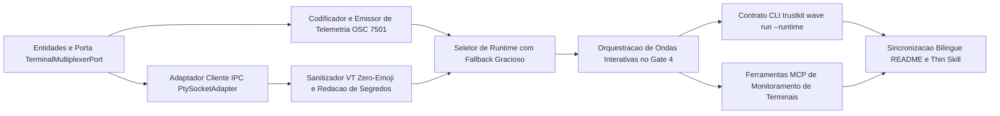

# Especificacao: 009-pty-multiplexer-and-agent-waves

## 1. Product Trio

- **PM**: Evolucao do TRustKit de um governador deterministico passivo para um orquestrador ativo de enxames de agentes construtores no Gate 4, integrando o runtime de pseudoterminais `multiplexador PTY` sem necessidade de fork, permitindo execucao paralela de agentes interativos (Claude Code, Antigravity CLI, Aider, Codex) dentro de Git Worktrees isoladas, deteccao semantica de bloqueios via protocolo `OSC 7501` e sobrevivencia de sessoes em background.
- **Tech Lead**: Extensao hexagonal dos crates `trustkit-core`, `trustkit-orch` e `trustkit-cli`, introduzindo: porta de dominio pura `TerminalMultiplexerPort` e tipos algebricos livres de `null`; codificador nativo do protocolo `OSC 7501`; adaptador cliente JSON-RPC 2.0 sobre Unix Domain Socket (`PtySocketAdapter`) consumindo a especificacao OpenRPC do `multiplexador PTY` (`terminal.run`, `terminal.wait`, `terminal.read`, `terminal.send`, `terminal.kill`); sanitizador de buffers VT para cumprimento estrito da proibicao de emojis; seletor de runtime com fallback gracioso para `AsyncExecutionSupervisor`; e ferramentas MCP para inspecao e desbloqueio de terminais de agentes.
- **Design / QA**: Criterios de aceitacao BDD/Gherkin garantindo despacho de ondas em PTYs isolados com overhead de IPC < 5ms, deteccao deterministica de estados (`Working`, `Blocked`, `Done`, `Failed`), sanitizacao 100% livre de emojis e segredos nas evidencias SQLite WAL (`.trustkit/state.db`), fallback automatico sem panics quando o daemon `multiplexador PTY` estiver ausente e paridade bilingue na documentacao.

## 2. Diagrama de Fluxo (Mermaid)

## 3. Criterios de Aceitacao (Gherkin)

### Cenario 1: Modelagem de Dominio e Porta `TerminalMultiplexerPort` (Atendimento de RF-053)

- **Dado** que o crate `trustkit-core` define as fronteiras de abstracao hexagonal usando apenas a biblioteca padrao (`std`)
- **Quando** um pedido de provisionamento de sessao de agente interativo `MultiplexedTerminalRequest` e construido
- **Entao** o dominio utiliza tipos algebricos estritos (`MultiplexedTerminalHandle`, `AgentSemanticState`, `BlockReasonKind`, `RuntimeBackendMode`) 100% livres de `null` e expoe a trait `TerminalMultiplexerPort` para criacao, leitura, envio de input, espera de estado e encerramento de PTYs.

### Cenario 2: Emissao Nativa de Telemetria de Estado `OSC 7501` pelo Binario `trustkit` (Atendimento de RF-054)

- **Dado** que o binario `trustkit` executa transicoes nos Gates 0 a 6 ou aguarda confirmacao interativa no terminal
- **Quando** o codificador `Osc7501Encoder` formata o estado atual da operacao (`working`, `blocked`, `done`, `error`) e o progresso percentual (`0..100`)
- **Entao** o processo emite sequencias validas `\x1b]7501;state=...:id=...:kind=...:progress=...\x1b\` compativeis com o parser `ghostty-vt`  sem introduzir emojis ou caracteres proibidos.

### Cenario 3: Adaptador Cliente JSON-RPC 2.0 sobre Unix Domain Socket para `multiplexador PTY` (Atendimento de RF-055)

- **Dado** que o daemon oficial `multiplexador PTY` esta ativo e escutando em seu socket local OpenRPC
- **Quando** o `PtySocketAdapter` em `trustkit-orch` despacha chamadas `terminal.run`, `terminal.get`, `terminal.wait`, `terminal.send`, `terminal.read` ou `terminal.kill`
- **Entao** a comunicacao JSON-RPC 2.0 ocorre com latencia de IPC < 5ms, mapeando erros de socket ou protocolo em `DomainViolation::InfrastructureBoundaryFault` sem uso de `unwrap()` ou `panic!()`.

### Cenario 4: Sanitizacao de Buffers de Terminal VT e Conformidade Zero-Emoji (Atendimento de RF-056)

- **Dado** que a saida capturada via `terminal.read` de um agente ou multiplexador externo pode conter sequencias ANSI, icones Unicode ou credenciais em texto claro
- **Quando** o `TerminalOutputSanitizer` processa o buffer antes de construir a entidade `ExecutionEvidence`
- **Entao** todos os emojis, badges graficos, trailers de autoria IA e tokens sensiveis sao expurgados ou mascarados antes da gravacao no banco SQLite WAL (`.trustkit/state.db`).

### Cenario 5: Seletor de Runtime com Fallback Gracioso para Supervisor Nativo (Atendimento de RF-057)

- **Dado** uma execucao configurada em modo `RuntimeBackendMode::Auto` em um ambiente onde o daemon `multiplexador PTY` nao esta instalado ou nao esta em execucao
- **Quando** o `SupervisorRuntimeSelector` verifica a disponibilidade do socket local do `multiplexador PTY`
- **Entao** o orquestrador degrada graciosamente para o `AsyncExecutionSupervisor` baseado em `tokio::process::Command` em modo `RuntimeBackendMode::Native`, registrando a evidencia de runtime utilizado sem interromper o fluxo.

### Cenario 6: Execucao Autonoma de Ondas de Agentes em Git Worktrees no Gate 4 (Atendimento de RF-058)

- **Dado** uma onda planejada no DAG contendo multiplas tarefas atomicas (`TASK-NNN.md`) e uma especificacao congelada com selo BLAKE3
- **Quando** o caso de uso `run_execution_wave` e acionado com um provedor `TerminalMultiplexerPort` ativo
- **Entao** cada tarefa tem sua Git Worktree provisionada, um terminal PTY dedicado e aberto no `cwd` da worktree executando o agente construtor, o estado semantico e monitorado ate atingir `AgentSemanticState::Done` (ou sinalizar bloqueio em `AgentSemanticState::Blocked`) e o merge deterministico ocorre somente apos validacao de integridade.

### Cenario 7: Evolucao do Comando CLI `trustkit wave run` com Flags de Runtime (Atendimento de RF-059)

- **Dado** o parser de linha de comando Clap em `trustkit-cli`
- **Quando** o usuario ou agente orquestrador executa `trustkit wave run --wave <N> --runtime <auto|pty|native> [--agent-cmd "<cmd>"] --json`
- **Entao** o comando valida os parametros, aciona o runtime selecionado e retorna no JSON o status individual de cada terminal provisionado, identificadores de pane/terminal e hashes de merge.

### Cenario 8: Ferramentas MCP para Inspecao e Desbloqueio de Terminais de Agentes (Atendimento de RF-060)

- **Dado** o servidor MCP nativo rodando via `trustkit mcp serve`
- **Quando** um agente orquestrador invoca as ferramentas `trustkit_wave_status`, `trustkit_terminal_inspect` ou `trustkit_terminal_send`
- **Entao** o servidor MCP consulta ou envia instrucoes aos terminais gerenciados pelo `PtySocketAdapter` em JSON-RPC 2.0 estrito, permitindo destravar agentes em estado `Blocked` sem sair do cliente MCP.

### Cenario 9: Atualizacao Bilingue da Documentacao e da Thin Skill `trustkit-sdd` (Atendimento de RF-061)

- **Dado** a incorporacao do adaptador `multiplexador PTY` e da telemetria `OSC 7501` ao ecossistema TRustKit
- **Quando** os arquivos `README.md`, `README.en.md` e `.agents/skills/trustkit-sdd/SKILL.md` forem atualizados
- **Entao** a documentacao descreve em paridade bilingue a arquitetura sem fork via OpenRPC, as novas flags do Gate 4 e as ferramentas MCP, mantendo zero emojis e zero trailers de IA.

## 4. Matriz de Rastreabilidade

| Regra Negocio | Requisito Funcional | Tarefa | No Mermaid | Teste Unitario / Integracao | Evidencia / Verificacao |
| :--- | :--- | :--- | :--- | :--- | :--- |
| RN-001 | RF-053 | TASK-001 | Node1 | crates/trustkit-core/src/terminal_multiplexer_entities_tests.rs | EV-001-terminal-multiplexer-port.json |
| RN-002 | RF-054 | TASK-002 | Node2 | crates/trustkit-core/src/osc7501_encoder_tests.rs | EV-002-osc7501-telemetry.json |
| RN-003 | RF-055 | TASK-003 | Node3 | crates/trustkit-orch/tests/pty_socket_adapter_tests.rs | EV-003-pty-socket-rpc.json |
| RN-004 | RF-056 | TASK-004 | Node4 | crates/trustkit-orch/tests/terminal_output_sanitizer_tests.rs | EV-004-vt-sanitizer-zero-emoji.json |
| RN-005 | RF-057 | TASK-005 | Node5 | crates/trustkit-orch/tests/supervisor_runtime_selector_tests.rs | EV-005-runtime-fallback.json |
| RN-006 | RF-058 | TASK-006 | Node6 | crates/trustkit-core/tests/run_interactive_wave_tests.rs | EV-006-interactive-wave-gate4.json |
| RN-007 | RF-059 | TASK-007 | Node7 | crates/trustkit-cli/tests/cli_wave_run_runtime_tests.rs | EV-007-cli-wave-runtime.json |
| RN-008 | RF-060 | TASK-008 | Node8 | crates/trustkit-orch/tests/mcp_terminal_tools_tests.rs | EV-008-mcp-terminal-tools.json |
| RN-009 | RF-061 | TASK-009 | Node9 | crates/trustkit-ast/tests/skill_trustkit_sdd_tests.rs | EV-009-docs-and-skill-sync.json |
